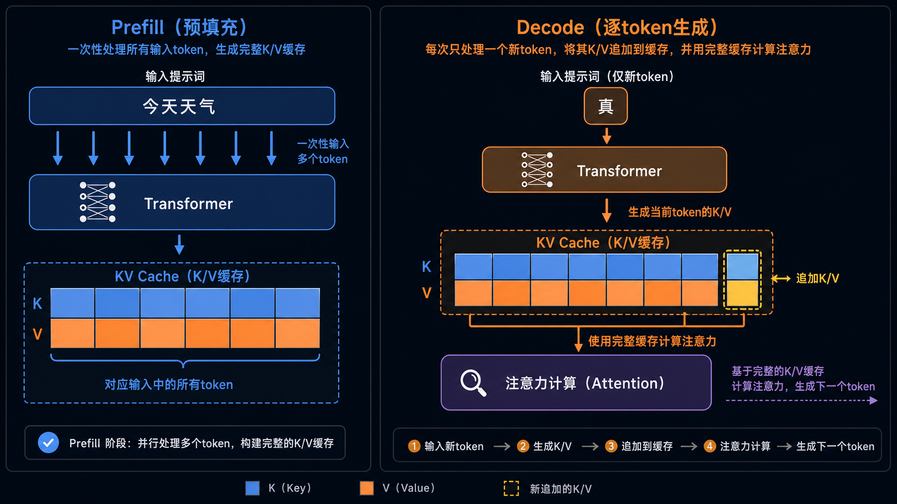
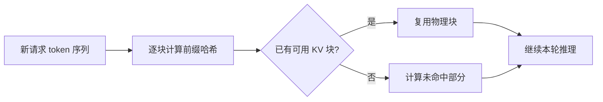

# KV Cache 和 Prompt Cache 的区别

API 响应中的 `cached_tokens` 与推理框架里的 KV Cache 都涉及缓存，但观察角度不同：KV Cache 是模型推理时保存的历史状态；Prompt Cache 通常指服务跨请求复用相同前缀的状态。

先看一次生成内部为什么可以缓存，再看状态如何跨请求复用，就容易区分两者。

## 一、KV Cache：复用历史位置的计算

自回归模型根据已有序列预测下一个 token。若每一步都对完整序列重新执行前向，就会重复计算历史位置的中间表示。

在因果注意力中，位置 $i$ 只能访问自身和此前的位置。追加后续 token 不会改变历史位置已有的表示，因此各层已经算出的 K 和 V 可以保留。深层 K/V 也包含此前上下文的信息，因果约束使这些历史状态保持可复用。

Prefill 阶段处理输入，建立各层的 KV；Decode 阶段处理新 token，计算新的 Q/K/V，再用新 Q 查询历史 K/V。对长度为 $s$ 的序列，单个新 query 的注意力计算随 $s$ 线性增长。这里比较的是单步 Attention；生成多个 token 时，还要对各步的计算量求和。



### 一个可对照的实现

下面用单层 MHA 展示缓存逻辑，省略位置编码、FFN 和输出词表投影。它接受当前片段及已有缓存，同时为 Prefill 和多 token 追加构造正确的因果 mask。

```python
import math
import torch
from torch import nn

class CachedAttention(nn.Module):
    def __init__(self, dim=64, heads=4):
        super().__init__()
        assert dim % heads == 0
        self.heads = heads
        self.head_dim = dim // heads
        self.qkv = nn.Linear(dim, 3 * dim, bias=False)
        self.out = nn.Linear(dim, dim, bias=False)

    def forward(self, x, cache=None):
        batch, current, dim = x.shape
        q, k, v = self.qkv(x).chunk(3, dim=-1)
        def split(t):
            return t.view(batch, current, self.heads, self.head_dim).transpose(1, 2)
        q, k, v = map(split, (q, k, v))
        previous = 0 if cache is None else cache[0].size(2)
        if cache is not None:
            k = torch.cat((cache[0], k), dim=2)
            v = torch.cat((cache[1], v), dim=2)
        scores = q @ k.transpose(-2, -1) / math.sqrt(self.head_dim)
        q_positions = previous + torch.arange(current, device=x.device)
        k_positions = torch.arange(k.size(2), device=x.device)
        future = k_positions[None, :] > q_positions[:, None]
        scores = scores.masked_fill(future, float("-inf"))
        output = torch.softmax(scores, dim=-1) @ v
        output = output.transpose(1, 2).contiguous().view(batch, current, dim)
        return self.out(output), (k, v)

# 对比完整前向与分段缓存，使用相同权重和输入
model = CachedAttention().eval()
x = torch.randn(1, 6, 64)
with torch.no_grad():
    full, _ = model(x)
    prefix, cache = model(x[:, :4])
    suffix, cache = model(x[:, 4:], cache)
    torch.testing.assert_close(full, torch.cat((prefix, suffix), dim=1))
```

代码中的 `torch.cat` 每次都分配并拷贝缓存，只适合展示机制。实际服务会使用预分配缓冲区或块池，避免反复复制全部历史 KV。完整模型还需要保证位置编码、每层缓存和模型配置一致。

### 显存成本

对所有层都使用全注意力的 MHA/GQA 模型，单条请求的 KV 存储为：

$$M_{KV}=2\cdot L\cdot H_{KV}\cdot d_h\cdot s\cdot b$$

分别对应 K/V 两份、层数、KV head 数、head dimension、已缓存 token 数和每元素字节数。并发请求的长度应分别求和。

以 [Qwen3-8B 配置](https://huggingface.co/Qwen/Qwen3-8B/blob/main/config.json) 为例，36 层、8 个 KV head、head dimension 128，BF16 缓存每 token 为 144 KiB。单条 4096-token 请求为 0.5625 GiB，8 条同长度请求为 4.5 GiB。换成 MHA、MLA 或混合注意力模型时，需要按实际结构重算。

### 按块分配

如果按最大长度为每条请求预留连续 KV 空间，短请求会占住未使用的容量，反复分配释放还可能产生碎片。PagedAttention 将缓存切成固定大小的块，用块表映射逻辑位置与物理块，让请求按需增加缓存。

例如取 block size 16，一个请求的物理块编号可以是 `[7, 1, 5]`。Attention Kernel 根据块表读取这些位置，无需把它们拼成连续区域。最后一个块仍可能未填满，因此按块分配减少浪费，并非完全消除碎片。

块也可以被多个请求引用，为前缀复用提供存储基础。但如何识别相同前缀、保留多久和优先淘汰谁，还需要额外的管理逻辑。

## 二、Prompt Cache：跨请求复用前缀

只管理单次生成的缓存时，请求结束后就可以回收其 KV。若后续请求带有相同的 system prompt、示例或对话历史，服务可以继续保留这些状态，跳过公共前缀的重复 Prefill。

这种复用通常称为 Prompt Caching 或 Prefix Caching。可复用的前缀必须对应相同的模型状态；token 内容、位置、模型或适配器等条件变化，都可能使缓存失效。它节省的是已命中部分的 Prefill，后续 Decode 仍需读取已有上下文。

### OpenAI：自动缓存与路由

OpenAI 在支持缓存的模型上自动管理前缀缓存，响应会报告命中的 token 数。例如 Chat Completions 的 usage 可以包含：

```json
{
  "prompt_tokens": 2006,
  "prompt_tokens_details": {"cached_tokens": 1920}
}
```

这表示有 1920 个输入 token 被计为缓存命中。是否满足最小长度、命中后的费用和保留策略，要结合模型与服务条款查看。本例仍有 86 个输入 token 未命中缓存。

服务会利用前缀信息和 `prompt_cache_key` 等信息影响路由。实际路由还受服务负载影响，命中仍需要前缀内容一致。固定指令和示例放在前面、每次变化的内容放在后面，有助于保留可复用前缀。[OpenAI Prompt Caching 文档](https://developers.openai.com/api/docs/guides/prompt-caching)

### Anthropic：缓存断点与回查

Anthropic 可以通过 `cache_control` 标记缓存边界。缓存前缀按 `tools → system → messages` 的顺序构成，断点之前的内容同样需要精确匹配。显式断点让调用方控制哪些前缀参与缓存。

下面只展示 system 内容块的结构。示例文本很短，实际缓存还需满足所选模型的最小长度要求：

```json
{
  "type": "text",
  "text": "此处放需要跨请求复用的固定指令与背景资料。",
  "cache_control": {"type": "ephemeral"}
}
```

标记一个断点会在该位置写入一个前缀条目，不会自动为之前每个内容块建立条目；多个显式断点可用于不同变化频率的部分。读取时，系统可以从断点向前检查有限的位置，寻找此前已经写入的匹配条目。文档描述的窗口为最多 20 个检查位置，包含断点本身；这里的内容块不是固定 100 或 200 token 的内存页。

因此，“system 没变”本身还不够：对应位置必须有可命中的缓存条目。固定前缀后经常接变化内容时，应把断点放在固定部分的末尾，避免缓存边界随变化后缀一起失效。自动缓存模式则由服务移动缓存边界，仍受匹配、回查范围和保留时间约束。[Anthropic Prompt Caching 文档](https://platform.claude.com/docs/en/build-with-claude/prompt-caching)

### vLLM：块哈希索引

vLLM APC 为完整 KV 块建立前缀相关的标识，可概括为：

$$h_j=\operatorname{hash}(h_{j-1},\text{tokens}_j,\text{extra identity})$$

父哈希让当前块的标识依赖此前前缀。新请求逐块计算标识并查缓存，命中的物理块增加引用，未命中部分再计算。LoRA、多模态输入和缓存隔离信息等也可能参与标识。



引用计数归零后，块可以进入回收候选，但已有内容仍可能保留到重新分配时。缓存池也可能预先保留 GPU 显存，因此块回收不等于马上把显存归还给驱动。[vLLM APC 设计文档](https://docs.vllm.ai/en/latest/design/prefix_caching/)

## 三、如何区分收益

| 观察点 | 单次生成中的 KV Cache | 跨请求的 Prompt Cache |
|---|---|---|
| 复用对象 | 已计算历史位置的 K/V | 已缓存公共前缀的状态 |
| 主要节省 | Decode 中的重复前向计算 | 相同前缀的重复 Prefill |
| 管理重点 | 容量、位置与追加 | 匹配、保留、路由与淘汰 |
| 主要代价 | 历史状态占用显存 | 保留旧状态占用缓存容量 |

两者可以使用同一批 KV 张量，不必实现成两套独立存储。评估缓存效果时，应分别观察命中 token 数、Prefill 计算量、首 token 延迟和可用并发。命中率提高，但缓存挤占了活跃请求所需空间，也可能降低整体服务能力。
