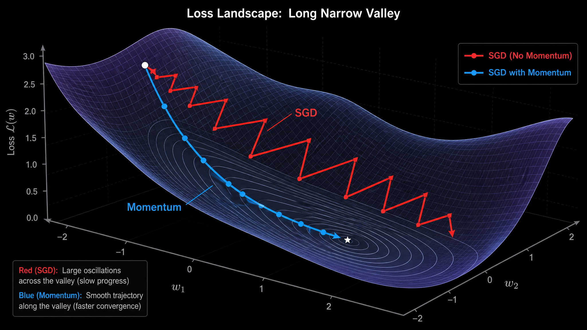
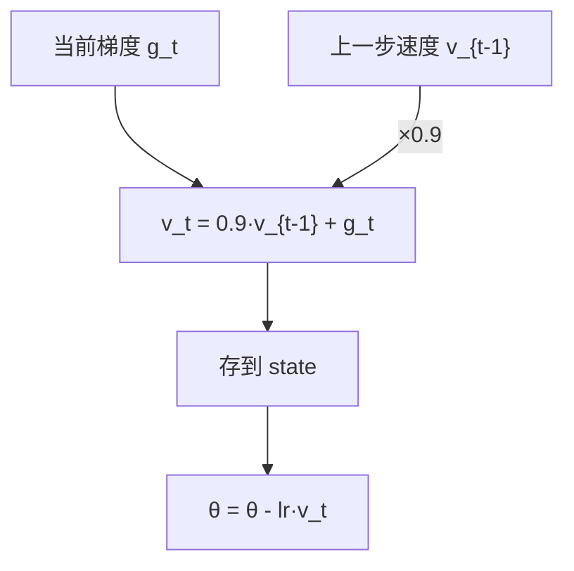
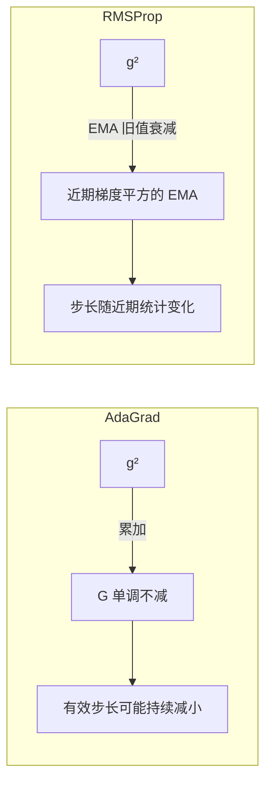
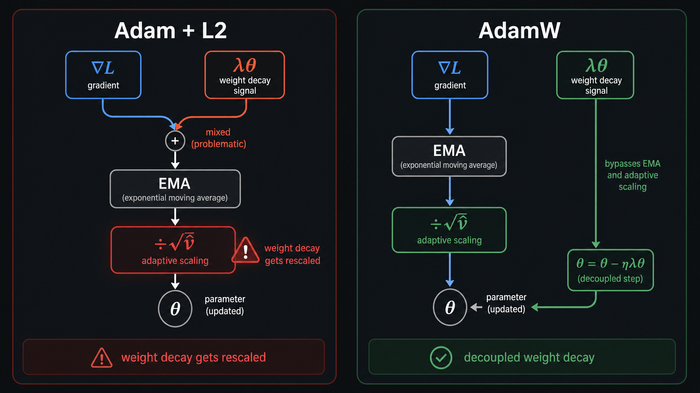
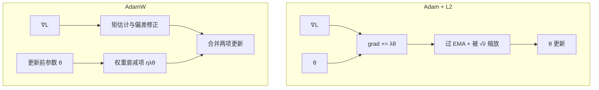

# Optimizer：从 SGD 到 AdamW

优化器根据梯度更新模型参数，但当前梯度并不能直接决定最合适的更新幅度。不同方向的曲率、mini-batch 噪声与历史梯度尺度，都会影响训练能否稳定推进。

普通 SGD 使用当前批次的梯度：

```python
for x, y in dataloader:
    optimizer.zero_grad()
    loss = model(x, y)
    loss.backward()
    optimizer.step()  # theta <- theta - lr * grad
```

当损失曲面在不同方向上的曲率相差很大时，同一学习率可能让参数在陡峭方向来回震荡，却在平缓方向前进缓慢。Momentum 累积历史梯度，用于缓解这类更新中的震荡。



---

## 一、Momentum：累积历史梯度

Momentum 在当前梯度之外保留一个累积量，更新方向同时受此前梯度影响：

$$v_t = \beta \cdot v_{t-1} + g_t$$

$$\theta_{t+1} = \theta_t - \eta \cdot v_t$$

$v_t$ 是历史梯度的指数加权和，距离当前越远，权重越小。这里采用未乘 $1-\beta$ 的写法；$\beta=0.9$ 是常见设置，具体值由任务选择。

若某个方向上的梯度反复变号，历史项会部分抵消；若持续同号，累积量会增强。它能缓解一些震荡，但仍需要合适的学习率。



代码上，Momentum 只比 SGD 多存一个跟参数同 shape 的 tensor：

```python
# torch.optim.SGD(params, lr=0.01, momentum=0.9)
# 每个参数多一个 buffer：
# state = {'momentum_buffer': v_t}    # 形状和参数一样，fp32

buf = state['momentum_buffer']
buf.mul_(0.9).add_(grad)    # v_t = 0.9 * v_{t-1} + g_t
p.data.add_(buf, alpha=-lr) # θ = θ - lr * v_t
```

Momentum 保留了梯度方向的历史信息。另一个独立的问题是步长：不同参数的梯度尺度与出现频率不同，统一学习率未必适合所有参数。自适应方法进一步使用逐参数统计量调整更新幅度。

---

## 二、AdaGrad 和 RMSProp：自适应步长

AdaGrad 为每个参数累计历史梯度平方，并用其平方根缩放当前梯度：

$$G_t = G_{t-1} + g_t^2$$

$$\theta_{t+1} = \theta_t - \eta \cdot \frac{g_t}{\sqrt{G_t} + \epsilon}$$

$g_t$ 和 $G_t$ 都按元素计算。历史梯度平方和越大，有效步长越小；更新较少的参数可能保留较大的有效步长。

```python
# torch.optim.Adagrad
# state['sum'] 就是 G_t，跟参数同 shape：

state['sum'].addcmul_(grad, grad, value=1)    # G_t += g_t²
std = state['sum'].sqrt().add_(1e-8)            # √(G_t) + ε
p.data.addcdiv_(grad, std, value=-lr)           # θ -= lr * g_t / std
```

$G_t$ 单调增加，长期训练中有效步长可能持续减小。这是 AdaGrad 更新规则的性质，在某些任务中有用，在另一些任务中则可能让后期进展过慢。

RMSProp 改了这一行：不累加，改用指数移动平均。

$$E[g^2]_t = 0.9 \cdot E[g^2]_{t-1} + 0.1 \cdot g_t^2$$

$$\theta_{t+1} = \theta_t - \eta \cdot \frac{g_t}{\sqrt{E[g^2]_t} + \epsilon}$$

RMSProp 用指数移动平均替代累计和。100 步前一项的相对权重衰减为 $0.9^{100}\approx2.7\times10^{-5}$，因此分母更侧重近期梯度尺度，而不随全部训练历史持续累积。



代码层面，AdaGrad 和 RMSProp 的差异就是一行：

```python
# AdaGrad：
state['sum'].addcmul_(grad, grad, value=1)          # 累加，永不衰减

# RMSProp：
square_avg.mul_(0.9).addcmul_(grad, grad, value=0.1) # EMA，旧值自然遗忘
```

Momentum 利用梯度的一阶历史信息，RMSProp 利用梯度平方调整尺度。这两类统计可以组合，Adam 就采用了这种方式。

---

## 三、Adam：一阶矩与二阶矩

Adam 把 Momentum 和 RMSProp 并到一个更新规则里：

$$m_t = 0.9 \cdot m_{t-1} + 0.1 \cdot g_t \qquad \text{（一阶矩：方向）}$$

$$v_t = 0.999 \cdot v_{t-1} + 0.001 \cdot g_t^2 \qquad \text{（二阶矩：步长）}$$

$$\theta_{t+1} = \theta_t - \eta \cdot \frac{\hat{m}_t}{\sqrt{\hat{v}_t} + 10^{-8}}$$

上式使用了偏差修正后的 $\hat m_t$ 和 $\hat v_t$。

$m_t$ 和 $v_t$ 初始化都是 0。第一步时 $m_1 = 0.1 \cdot g_1$——只有真实梯度的十分之一。因为 EMA 权重的累加和不等于 1。

EMA 从零初始化，早期累计权重和小于 1，估计会偏向零。偏差修正用累计权重和归一化：

$$\hat{m}_t = \frac{m_t}{1 - 0.9^t},\qquad \hat{v}_t = \frac{v_t}{1 - 0.999^t}$$

第一步 $m_1=0.1g_1$，修正后 $\hat m_1=g_1$。一阶矩和二阶矩的衰减系数不同：100 步时，一阶矩的累计权重和已接近 1，而二阶矩仍需要明显修正。

```python
# torch.optim.Adam 内部，每个参数维护：
# state = {
#     'step': 0,                            # t
#     'exp_avg':   m_t,                     # 一阶矩，跟参数同 shape
#     'exp_avg_sq': v_t,                     # 二阶矩，跟参数同 shape
# }

exp_avg.mul_(0.9).add_(grad, alpha=0.1)            # m_t = 0.9·m + 0.1·g
exp_avg_sq.mul_(0.999).addcmul_(grad, grad, value=0.001)  # v_t = 0.999·v + 0.001·g²

bias1 = 1 - 0.9 ** step
bias2 = 1 - 0.999 ** step
denom = exp_avg_sq.sqrt().div_(math.sqrt(bias2)).add_(1e-8)

p.data.addcdiv_(exp_avg, denom, value=-lr / bias1)
```

---

## 四、AdamW：解耦权重衰减

训练时经常会加 L2 正则化——在 loss 里加一项让权重趋向 0，防止过拟合。

不带 Momentum 的 SGD 中，在损失上增加 $\frac{\lambda}{2}\|\theta\|^2$，会在每步更新中增加 $-\eta\lambda\theta$，与相同系数的权重衰减等价。这里写明 $1/2$，以统一梯度中的系数。

Adam 里不等价。因为 Adam 会把 L2 正则化的梯度也送进 EMA，还被 $\sqrt{v_t}$ 缩放。

L2 产生的梯度与任务梯度一起进入一阶、二阶矩统计，最终更新又经过逐参数缩放，因此其作用不再等同于每步按固定比例缩小权重。缩放强度取决于实际的梯度历史。

AdamW 的修正就是把 weight decay 从自适应机制里拆出来，直接作用在权重上：

$$\theta_{t+1} = \theta_t - \eta \cdot \frac{\hat{m}_t}{\sqrt{\hat{v}_t} + \epsilon} - \eta \cdot \lambda \cdot \theta_t$$

最后一项直接按比例衰减参数，不经过梯度矩估计。在应用了同一衰减系数的参数组内，比例相同；实际训练也可以将 bias、Norm 等参数放进不同参数组。

```python
# Adam 里 weight_decay 的路径：
# grad += param * weight_decay     # 混入梯度 → 过 EMA → 被 √v̂ 缩放

# AdamW 里：
p.data.mul_(1 - lr * weight_decay)          # 直接衰减，不经过任何缩放
p.data.addcdiv_(exp_avg, denom, value=-lr / bias1)  # 与上文相同的偏差修正
```





[AdamW 原论文](https://arxiv.org/abs/1711.05101) 讨论了自适应优化中 L2 正则与权重衰减的差异。实验收益取决于任务、学习率和衰减系数的共同选择。

---

这些方法分别调整更新的不同部分：Momentum 累积方向，AdaGrad/RMSProp 调整逐参数尺度，Adam 结合一阶与二阶矩，AdamW 将权重衰减独立出来。

选择优化器时，除了验证收敛与泛化，还要计算状态显存。Momentum 多保存一份累积量，Adam 类方法通常保存两份矩统计；参数规模增大后，这些额外状态会成为分布式训练的重要成本。
