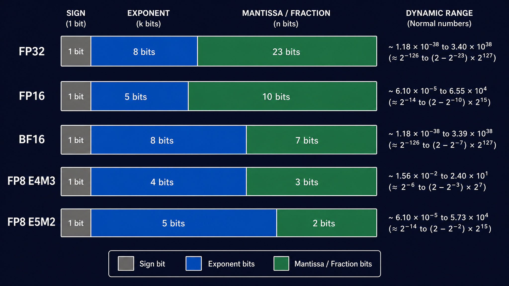
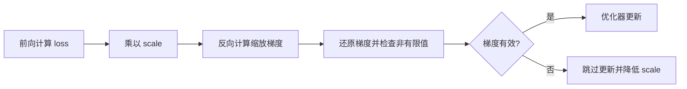

# Mixed Precision：从 FP32 到 FP8

训练一个 7B 模型，显存里需要保存的远不止权重。若参数、梯度以及 Adam 的两个状态都用 FP32，仅这四份张量就需要 112 GB，还未计入激活。一张 80 GB 显卡无法容纳。

混合精度将部分计算改用低精度，同时在需要的位置保留高精度状态。收益来自更小的激活、更低的访存量和更高的矩阵计算吞吐；能节省多少总显存，还取决于优化器与参数的存储方式。

## 一、训练状态的显存

设参数量 $N=7\times10^9$，全文按十进制 GB 计算。全 FP32 的 Adam 训练状态为：

$$M=\underbrace{4N}_{参数}+\underbrace{4N}_{梯度}+\underbrace{4N+4N}_{Adam一阶与二阶矩}=16N=112\text{ GB}$$

Adam 的两个状态分别累计梯度的一阶矩与二阶矩：

$$m_t=\beta_1m_{t-1}+(1-\beta_1)g_t,\qquad v_t=\beta_2v_{t-1}+(1-\beta_2)g_t^2$$

低精度计算不代表这些状态也一起降低位宽。一种显式保留 master weights 的配置如下：

| 状态 | 数据类型 | 7B 模型占用 |
|---|---|---|
| 计算用权重 | BF16 / FP16 | 14 GB |
| 梯度 | BF16 / FP16 | 14 GB |
| Master weights | FP32 | 28 GB |
| Adam 一阶与二阶矩 | FP32 | 56 GB |
| 合计 | — | 112 GB |

这里的状态总量与全 FP32 相同。若梯度用 FP32 存储，则还会增加。采用 PyTorch autocast、FP32 参数且没有独立低精度参数副本时，存储构成又不同。因此，“混合精度把训练总显存减半”不适合作为通用估算。

计算吞吐要单独比较。例如 A100 的常规 FP32 与 BF16 Tensor Core 峰值差别很大，但 FP32 输入也可能通过 TF32 使用 Tensor Core。实际收益取决于算子、精度配置和输入形状，不能直接用两个峰值相除预测训练速度。

## 二、FP16 的数值限制

FP16 由 1 位符号、5 位指数和 10 位尾数组成。它的最大有限值为 65504，最小正正规数约为 $6.10\times10^{-5}$；次正规数还能表示到约 $5.96\times10^{-8}$，但越接近零，有效精度越低。



训练中主要关注三类问题。

**下溢。** 很小的梯度可能舍入为零，次正规数的处理也受硬件与算子路径影响。下面展示数值转换，不能把最小正规数误当作直接归零的阈值：

```python
import torch

grad = torch.tensor([1e-5, 5e-7, 1e-8], dtype=torch.float32)
print(grad.half().float().tolist())
# 约为 [1.00136e-05, 4.76837e-07, 0.0]
```

**上溢。** 超过可表示范围的结果可能变成 `inf`，并在后续计算中产生 `nan`。归一化和高精度累加能缓解部分问题，但不能保证任意训练配置都稳定。

**小更新丢失。** 即使梯度不为零，更新量也可能小于参数附近的浮点间隔，减法后参数保持不变：

```python
theta = torch.tensor([100.0], dtype=torch.float16)
update = torch.tensor([0.001], dtype=torch.float16)
print((theta - update).item())  # 100.0
```

FP16 在 1 附近的相邻数间距为 $2^{-10}$。其他数值附近的间距取决于指数与舍入方式，因此不能用一个简单不等式精确判定所有更新何时消失。

## 三、混合精度与 Loss Scaling

[Mixed Precision Training](https://arxiv.org/abs/1710.03740) 介绍了低精度计算、高精度参数更新和 loss scaling 等技术。显式 master weights 方案用低精度副本执行前向与反向，再在 FP32 参数上应用更新，减少小更新被低精度舍入丢失的问题。

Loss Scaling 在反向前把损失乘以 $S$，使梯度按相同比例放大：

$$L'=S\cdot L,\qquad g'=S\cdot g$$

更新前再除以 $S$。在实数运算中，这不会改变梯度；在浮点运算中，它让一部分原本过小的梯度进入更容易表示的范围。缩放过大也会造成上溢，所以需要检查非有限值并调整缩放因子。



PyTorch 的一种常见用法是保留 FP32 模型参数，由 autocast 为合适算子选择计算精度，再由 GradScaler 管理缩放。它不要求用户手写一套 master weights 复制循环：

```python
from torch.amp import autocast, GradScaler

scaler = GradScaler("cuda")
for inputs, targets in dataloader:
    optimizer.zero_grad(set_to_none=True)
    with autocast("cuda", dtype=torch.float16):
        logits = model(inputs)
        loss = loss_fn(logits, targets)
    scaler.scale(loss).backward()
    scaler.step(optimizer)
    scaler.update()
```

这里的 `model`、`loss_fn` 和数据加载器由任务提供。若需要裁剪梯度，应先调用 `scaler.unscale_(optimizer)`，再裁剪，避免阈值作用在放大后的梯度上。

Autocast 按算子和设备策略选择精度。矩阵乘法等操作适合低精度，一些数值敏感操作保留 FP32；具体规则应查所用 PyTorch 版本的[AMP 文档](https://docs.pytorch.org/docs/stable/amp.html)。形状对齐会影响内核效率，但未对齐不等于一定无法使用 Tensor Core。

## 四、BF16 的取舍

BF16 保留与 FP32 相同的 8 位指数，尾数缩短到 7 位。它的动态范围比 FP16 大得多，通常不需要为避免梯度下溢而使用 loss scaling；代价是同一数值附近的表示精度更低。

```python
from torch.amp import autocast

for inputs, targets in dataloader:
    optimizer.zero_grad(set_to_none=True)
    with autocast("cuda", dtype=torch.bfloat16):
        loss = loss_fn(model(inputs), targets)
    loss.backward()
    optimizer.step()
```

省去 GradScaler 简化了流程，但 BF16 仍可能出现数值不稳定。遇到 loss spike，要检查异常输入、学习率、梯度范数以及具体算子的累加精度。Checkpoint 恢复是故障后的处理方式，不能替代定位原因。

## 五、与分布式训练组合

计算、梯度累积和通信可以采用不同精度。以两字节梯度做 AllReduce，比 FP32 减少一半原始数据量，但跨卡累加也会引入舍入误差。选择通信精度时，需要检查训练框架是否在通信前转换、使用什么累加方式，以及转换带来的额外开销。

ZeRO 则通过切分训练状态降低每卡占用：Stage 1 切分优化器状态，Stage 2 进一步切分梯度，Stage 3 再切分参数。用前面显式 master weights、低精度梯度的假设，8 卡 Stage 2 的状态占用可粗算为：

$$M_{\text{per GPU}}\approx\underbrace{2N}_{复制的低精度参数}+\frac{\underbrace{2N}_{梯度}+\underbrace{12N}_{master与Adam状态}}{8}=26.25\text{ GB}$$

这只是这组假设下的状态小计，尚未计入激活、通信 buffer 和临时聚合。框架是否将 master weights 作为优化器状态分片、梯度以什么类型累积，都需要按实际配置确认。

## 六、推理的精度策略

推理不保存训练所需的梯度和优化器状态，可以独立选择权重与 KV Cache 的精度。GPTQ、AWQ 等常见方案主要面向权重量化，不能统一描述成“激活也动态量化为 INT4/INT8”。

下面展示通过 Transformers 与 bitsandbytes 加载 INT8 权重的接口，使用配置公开的 Qwen3-8B；运行时需要支持相应版本和硬件：

```python
from transformers import AutoModelForCausalLM, BitsAndBytesConfig

quantization = BitsAndBytesConfig(load_in_8bit=True)
model = AutoModelForCausalLM.from_pretrained(
    "Qwen/Qwen3-8B",
    quantization_config=quantization,
    device_map="auto",
)
```

推理总显存还包括 KV、激活和工作空间。权重缩小四倍，不代表服务总占用也缩小四倍。

## 七、FP8 计算与缩放

FP8 的常见格式包括 E4M3 和 E5M2。前者有更多尾数位，后者有更大的动态范围。训练通常按张量用途选择格式和缩放方式，同时保留必要的高精度状态与累加。

在同一 H100 SXM、非稀疏口径下，FP8 Tensor Core 理论峰值约为 BF16 的两倍。这个比值只描述硬件计算吞吐，不能当作端到端训练加速比。[NVIDIA Hopper 架构说明](https://developer.nvidia.com/blog/nvidia-hopper-architecture-in-depth/)

NVIDIA Transformer Engine 提供低精度计算与缩放支持。Delayed Scaling 根据历史 amax 统计选择缩放因子，避免在当前计算的关键路径上等待完整的当前张量统计。不同缩放粒度与配方的适用性，需要结合硬件和训练效果选择；FP8 的计算格式也不决定优化器状态如何存储。

| 计算格式 | 主要收益 | 需要检查 |
|---|---|---|
| FP16 | 低精度矩阵吞吐、较小的计算张量 | 动态范围、loss scaling、参数更新精度 |
| BF16 | 较大的动态范围，通常无需 loss scaling | 尾数精度、累加方式 |
| FP8 | 更高吞吐、更低的数据传输量 | 缩放粒度、格式选择、算子覆盖与收敛 |

精度选择应同时验证状态显存、实际吞吐和任务效果。先明确哪些张量降精度、哪些状态保留 FP32，再与同一硬件上的基线比较，才能判断节省来自哪里。

参考：[NVIDIA 混合精度训练指南](https://docs.nvidia.com/deeplearning/performance/mixed-precision-training/index.html)。
