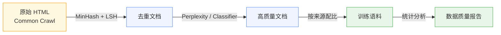
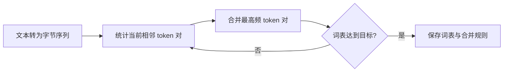
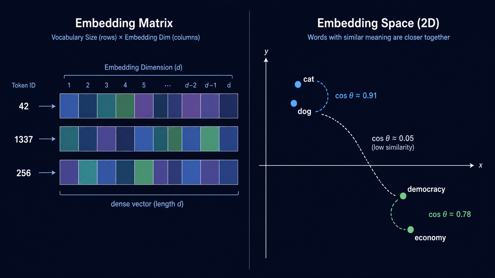
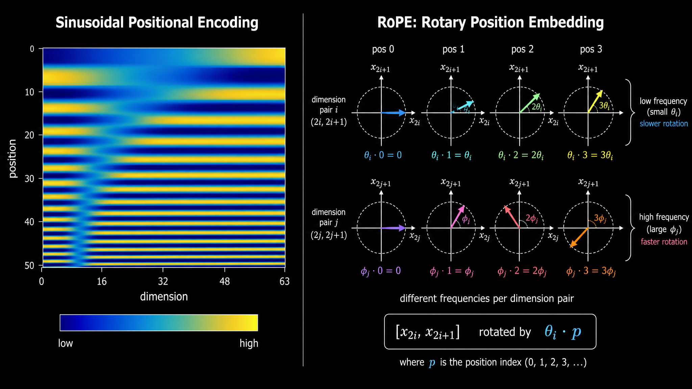
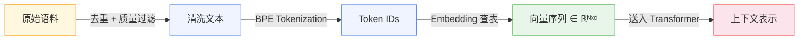

原始网页、代码和文档不能直接送入语言模型。训练前，需要提取正文、过滤与去重，再由 tokenizer 将文本编码成 token ID，最后通过 Embedding 查表得到向量。

这篇文章沿着这条数据管道，解释每一步如何改变模型看到的数据，以及它带来的存储和计算成本。

---

## 一、语料工程：从互联网到训练数据集

### 原始数据长什么样

网页语料常来自 Common Crawl 等来源。下面是一段示意 HTML，正文、广告和页脚混在一起：

```html
<html><head><title>Buy cheap shoes!!!</title></head>
<body>
  <div class="ad">CLICK HERE FOR DEALS</div>
  <p>The mitochondria is the powerhouse of the cell.</p>
  <p>The mitochondria is the powerhouse of the cell.</p>
  <footer>© 2024 spam-site.com</footer>
</body></html>
```

广告、重复内容、样板文字混在一起。直接拿去训练，模型会把网页噪声当作语言模式来学习。

### 去重：MinHash + LSH

镜像、转载与模板页面会让相同内容反复进入语料。重复样本获得过高训练权重，可能增加记忆原文的倾向，也会浪费计算预算。

先把文档表示为词或字符 n-gram 的集合，再用 Jaccard 相似度衡量重叠。MinHash 可以用较短签名近似这种集合相似度。对于集合 $A$ 和 $B$：

$$J(A, B) = \frac{|A \cap B|}{|A \cup B|}$$

MinHash 的概率性质保证了签名匹配的概率恰好等于 Jaccard 相似度：

$$P(\text{minhash}(A) = \text{minhash}(B)) = J(A, B)$$

对每篇文档使用多个哈希得到签名，再通过 LSH 生成相似文档的候选对。落入同一桶只是候选信号，通常还需检查相似度阈值。

相似度结果取决于文本归一化、分词或 n-gram 规则。例如，是否移除标点会改变“同一句话多一个句号”的集合表示，相似度阈值也应与这套预处理规则一起确定。

### 质量过滤

去重之后，还需要过滤低质量文本。两种常见方法：

**Perplexity Filter：** 用一个小型语言模型计算文档的困惑度：

$$\text{PPL} = \exp\left(-\frac{1}{N}\sum_{i=1}^{N} \log P(x_i | x_{<i})\right)$$

困惑度高说明文本在所选语言模型下不容易预测，可能来自乱码，也可能来自专业领域、少数语言或新知识。低困惑度可能对应重复内容，也可能是正常的常见表达。过滤阈值需要按语言与来源校准，不能把困惑度当成通用质量分数。

**Classifier Filter：** 用筛选后的优质样本与背景网页训练分类器，再按分数筛选。分类器会继承标注与来源偏差，因此还要检查被删除样本，避免系统性丢失某些领域或语言。

### 数据配比与 Scaling Law

数据混合需要同时考虑来源、语言、质量、重复率和目标能力。代码占比提高会改变训练分布，但不保证所有编程评测都提升；某一来源的增加，也会减少固定预算下其他来源的训练机会。

计算预算可粗略写为 $C\propto ND$，其中 $N$ 是参数量、$D$ 是训练 token 数。这个关系描述计算量，不单独给出最优配比。[Chinchilla](https://arxiv.org/abs/2203.15556) 通过实验研究固定训练预算下如何分配模型规模与数据量；若还需考虑部署成本，团队也可能选择较小模型并训练更多 token。

工程上应记录每个来源的采样权重、实际 token 占比与重复采样次数，再用验证集检查能力变化。配比调整后，应检查各来源的实际训练量是否符合预期。

整个数据清洗流程可以用一张图概括：



清洗得到可训练的文本后，下一步是把它编码成模型接受的 token ID 序列。

---

## 二、Tokenization：文本的数字化

### 字符级、单词级、子词级

字符级编码容易覆盖文本，但序列往往较长。字符与字节也应区分：UTF-8 的一个字符可能占多个字节；256 是单字节的取值数，不是英文字符数量。

单词级编码需要很大的词表，还要处理未登录词。若把未见词统一映射为 `<UNK>`，就会丢失其具体拼写。

**子词级（Subword）** 取中间路线：常见词保持完整，罕见词拆分为子词片段。"unhappiness" → ["un", "happiness"]，即使模型没见过完整词，也能从子词组合推断含义。

### BPE 算法：从字节到子词

BPE 是常见子词算法。下面展示 byte-level BPE 的简化训练过程：从字节开始，反复合并高频相邻 token 对。实际 tokenizer 还可能使用文本归一化、预切分和特殊 token 规则。

合并过程：

1. 初始词表：所有单个字节（256 个）
2. 统计语料中所有相邻字节对的出现频率
3. 合并频率最高的字节对为新 Token，加入词表
4. 重复步骤 2-3，直到词表达到目标大小

下面用一小段英文语料演示合并。每次合并都会改变序列，下一轮据此重新统计 token 对。

演示所需的两个函数分别负责计数与合并：

```python
def get_stats(ids):
    """统计相邻 pair 的频率"""
    counts = {}
    for pair in zip(ids, ids[1:]):
        counts[pair] = counts.get(pair, 0) + 1
    return counts

def merge(ids, pair, new_id):
    """将语料中所有 (a, b) 替换为 new_id"""
    new_ids = []
    i = 0
    while i < len(ids):
        if i < len(ids) - 1 and ids[i] == pair[0] and ids[i+1] == pair[1]:
            new_ids.append(new_id)
            i += 2
        else:
            new_ids.append(ids[i])
            i += 1
    return new_ids

text = "the cat sat on the mat the cat ate the rat"
ids = list(text.encode('utf-8'))

for i in range(14):
    stats = get_stats(ids)
    pair = max(stats, key=stats.get)
    new_id = 256 + i
    ids = merge(ids, pair, new_id)
    print(f"合并 #{i}: {pair} -> {new_id} (频率: {stats[pair]})")
```



### 真实模型的 Tokenizer 长什么样

下面用 Qwen3-8B 的 tokenizer 检查英文、中文和代码的切分。只需下载 tokenizer 文件，无需加载模型权重：

```python
from transformers import AutoTokenizer

tokenizer = AutoTokenizer.from_pretrained("Qwen/Qwen3-8B")
for text in ["The quick brown fox", "缓存命中后跳过重复计算", "def add(a, b): return a + b"]:
    ids = tokenizer.encode(text, add_special_tokens=False)
    print(text)
    print(ids)
    print(tokenizer.convert_ids_to_tokens(ids))
    assert tokenizer.decode(ids) == text
```

不同 tokenizer 对空格、中文和代码的编码效率不同。同一文本在不同词表下的 token 数不能直接互换；评估吞吐或上下文容量时，应使用实际模型的 tokenizer。

### 词表大小的工程权衡

词表扩大可能减少某些文本的 token 数，但同时增加 Embedding 与输出词表投影的规模。实际效率还取决于 tokenizer 的训练语料、切分规则，以及更大输出层带来的计算开销。

Embedding 参数量为 $|V|\times d$。按 [Qwen3-8B 配置](https://huggingface.co/Qwen/Qwen3-8B/blob/main/config.json)，$|V|=151936$、$d=4096$，输入表约有 622M 参数。该模型输入与输出权重不共享，输出投影也需要单独计入。

Token ID 只是词表中的索引。ID 数值的大小与词义无关，模型需要通过可学习的向量表示利用这些离散符号。

---

## 三、Embedding：从离散 ID 到连续语义空间

### 从 one-hot 到稠密向量

最朴素的表示方式是 one-hot：token ID=42 对应一个 32000 维的向量，只有第 42 位是 1，其余全是 0。

这种表示有一个根本问题：任意两个不同的 one-hot 向量的内积都是 0。"cat" 和 "dog" 之间的相似度 = "cat" 和 "democracy" 之间的相似度 = 0。模型无法从 one-hot 中获得任何语义信息。

**Embedding 的做法：** 用一个查找表把离散 ID 映射到低维稠密向量。

$$\mathbf{e}_t = E[t] \in \mathbb{R}^{d}$$

其中 $E \in \mathbb{R}^{|V| \times d}$ 是可学习的参数矩阵，$|V|$ 是词表大小，$d$ 是隐藏维度。

```python
import torch
import torch.nn as nn

# 使用小尺寸展示查表，实际模型的矩阵大得多
embedding = nn.Embedding(1000, 64)
vec = embedding(torch.tensor(42))
print(vec.shape)  # torch.Size([64])

```

Embedding 表随训练更新，向量中会包含任务相关的统计关系。但不能保证任意语义相近词都按某种距离严格聚类。图中的聚类是示意，实际分析需要指定距离、层和上下文。



### 位置编码：让模型知道顺序

不带位置机制和因果 mask 的 Self-Attention 对输入排列具有等变性：输入重新排列，输出也按对应关系重排。它无法仅凭内容区分同一组 token 的不同顺序，因此需要位置机制。

位置信息可以加在输入向量上，也可以像 RoPE 一样作用于 Attention 中的 Q/K。

**正弦位置编码（原始 Transformer）：**

$$PE_{(pos, 2i)} = \sin\left(\frac{pos}{10000^{2i/d}}\right), \quad PE_{(pos, 2i+1)} = \cos\left(\frac{pos}{10000^{2i/d}}\right)$$

不同维度使用不同频率的正弦、余弦函数。它不需要学习位置表，可以计算训练长度之外的位置，但能计算不等于模型在更长序列上仍可靠。

**RoPE（旋转位置编码）：**

Qwen3 等模型使用 RoPE，通过旋转 query 和 key 编码位置信息。

对于位置 $m$ 的 query $\mathbf{q}_m$ 和位置 $n$ 的 key $\mathbf{k}_n$，位置相关部分依赖相对位置，分数同时取决于内容 $(m-n)$：

$$\mathbf{q}_m^\top \mathbf{k}_n = f(\mathbf{x}_m, \mathbf{x}_n, m-n)$$

RoPE 将向量维度两两配对，按位置旋转不同角度。点积中出现相对位置信息，同时保留内容相关性。扩展上下文还需要缩放策略、训练或验证，不能把旋转形式本身当成无限长度泛化的保证。



### Embedding 层的工程参数

Embedding 的初始化方式与学习率安排应以具体模型为准。Qwen3 配置中的初始化标准差为 0.02。Warmup 逐步提高训练初期的学习率，影响的是包括 Embedding 在内的整体优化过程。

---

数据管道的各阶段可以整理为：



输入 Embedding 是按 token ID 查表得到的，同一个 token 在不同句子中会取到相同的初始向量。后续 Transformer 层结合位置与可见上下文更新表示，才会区分它在具体句子中的用法。

下一篇讨论 Self-Attention 如何聚合上下文，以及这些计算在显存和 GPU 内核中如何实现。
