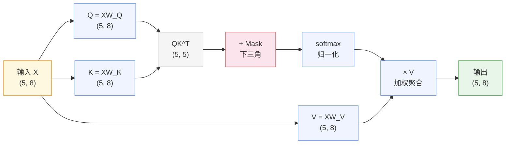
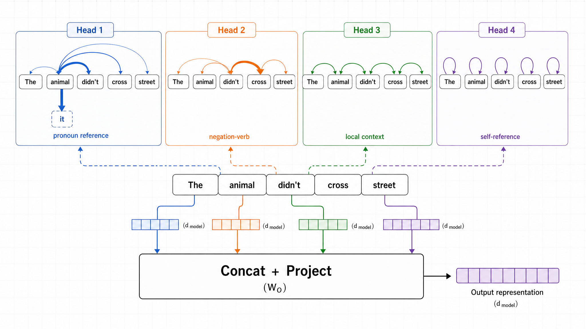
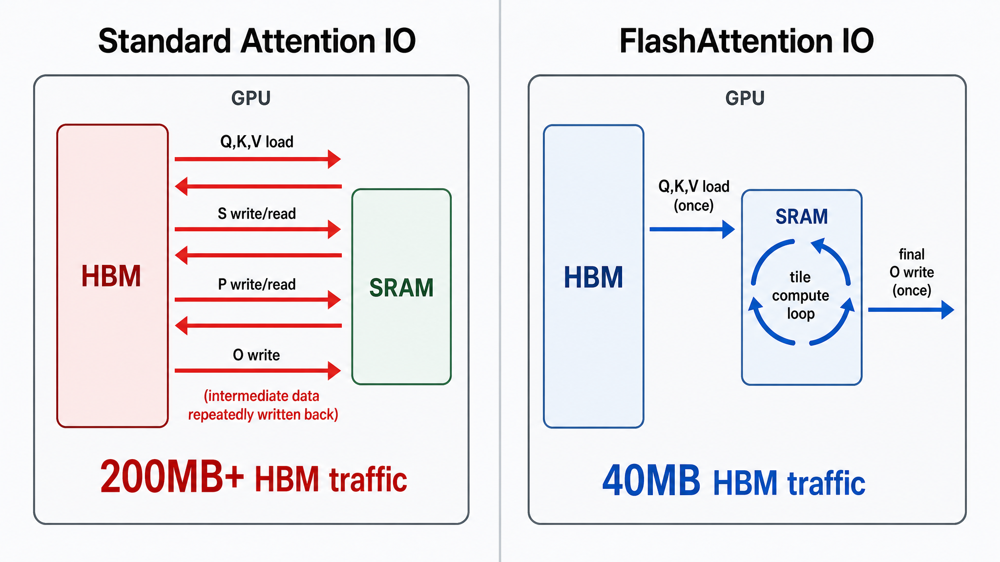
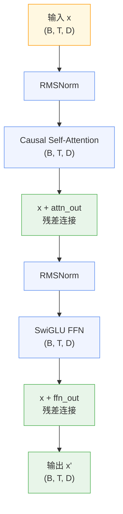

Embedding 查表为每个 token 提供初始向量，但同一个 token 在不同句子里仍会取到同一行参数。Transformer 通过 Attention 聚合上下文，再用前馈网络做非线性变换，形成与当前语境相关的表示。

本文先展开单层计算，再讨论多头结构、KV Cache 与 FlashAttention。示例以因果语言模型为主，每个位置只能访问自身及此前的 token。

---

## 一、Self-Attention 机制

给定一个长度为 $N$ 的 token 序列，每个 token 对应一个 $d$ 维向量。要让 token$_i$ 的表示融合其他 token 的信息，最直接的想法是加权平均——权重由 token$_i$ 和 token$_j$ 的相似度决定。这就是 Self-Attention 的起点。

### QKV 注意力分数

输入矩阵 $X \in \mathbb{R}^{N \times d}$（$N$ 个 token，每个 $d$ 维），通过三个可学习的投影矩阵得到：

$$Q = XW_Q, \quad K = XW_K, \quad V = XW_V$$

其中 $W_Q, W_K, W_V \in \mathbb{R}^{d \times d_k}$。

注意力输出定义为：

$$\text{Attention}(Q, K, V) = \text{softmax}\left(\frac{QK^T}{\sqrt{d_k}}\right)V$$

逐项拆解：

- $QK^T \in \mathbb{R}^{N \times N}$：注意力分数矩阵。$(i, j)$ 位置的值 = token$_i$ 对 token$_j$ 的关注程度。$Q$ 决定"我在找什么"，$K$ 决定"我有什么"，点积高说明匹配度高。
- $\sqrt{d_k}$：缩放因子。当 $d_k$ 较大时，点积的方差 $\propto d_k$，导致 softmax 输出趋近 one-hot（只有一个 token 获得全部权重）。除以 $\sqrt{d_k}$ 使方差回到 $\mathcal{O}(1)$，梯度更平滑。
- $\text{softmax}$：将分数归一化为概率分布，每行和为 1。
- 乘以 $V$：按注意力权重加权聚合 value 向量。注意力高的 token 的 $V$ 在输出中占更大比重。

下面用随机生成的 5 个位置展示张量运算，$N=5$、$d=8$。这不是对某个英文句子的真实分词或训练后注意力可视化：

```python
import torch
import math

torch.manual_seed(42)
N, d = 5, 8
X = torch.randn(N, d)           # 5 个 token 的 embedding
W_Q = torch.randn(d, d) * 0.1   # Q 投影
W_K = torch.randn(d, d) * 0.1   # K 投影
W_V = torch.randn(d, d) * 0.1   # V 投影

Q = X @ W_Q                     # (5, 8)
K = X @ W_K                     # (5, 8)
V = X @ W_V                     # (5, 8)

scores = Q @ K.T / math.sqrt(d) # (5, 5) 注意力分数
mask = torch.triu(torch.full((N, N), float('-inf')), diagonal=1)
scores = scores + mask          # 加 causal mask

attn_weights = torch.softmax(scores, dim=-1)  # (5, 5)
output = attn_weights @ V       # (5, 8) 加权聚合

print(f"注意力权重矩阵 shape: {list(attn_weights.shape)}")
print(attn_weights.round(decimals=3))
```

输出是一个下三角的 $5\times5$ 权重矩阵，每行和为 1。第 0 个位置只能访问自身；后续位置可以对此前各位置分配权重。随机投影尚未学到语言关系，不能据此解释具体词语之间的依赖。

### Causal Mask

因果 decoder-only 模型（如 Qwen3）在训练时只能看到当前 token 和之前的 token。mask 的做法是把 softmax 之前分数矩阵的上三角填为 $-\infty$：

$$\text{mask}_{ij} = \begin{cases} 0 & j \leq i \\ -\infty & j > i \end{cases}$$

softmax($-\infty$) = 0，因此未来位置的注意力权重全部为 0。



### 复杂度

$QK^T$ 是 $N\times N$ 的矩阵。仅考虑一个样本的一个 head，序列长度 4096 时有：

$$4096 \times 4096 = 16,777,216 \text{ 元素}$$

该矩阵用 FP32 存储占 64 MiB，FP16 占 32 MiB。批量与 head 数还要继续乘入。朴素 Attention 的分数矩阵空间复杂度为 $O(N^2)$，计算复杂度为 $O(N^2d_k)$；融合内核可以避免保存完整分数矩阵，但不因此消除全注意力的平方计算量。

Self-Attention 让每个 token 能"看到"前面的所有 token。但一套 QKV 只提供单一的注意力模式——它把所有上下文关系压缩到同一组权重里。

---

## 二、Multi-Head Attention 与前馈网络

### Multi-Head Attention

把 $d$ 维拆成 $h$ 个 head，每个 head 独立计算一组 QKV，然后拼接：

$$\text{head}_i = \text{Attention}(Q_i, K_i, V_i)$$
$$\text{MultiHead}(X) = \text{Concat}(\text{head}_1, \ldots, \text{head}_h) W_O$$

其中每个 head 的 $W_Q^i, W_K^i, W_V^i \in \mathbb{R}^{d \times d_k}$，$d_k = d / h$。

不同 head 可以学习不同类型的上下文关系。训练后的模型中，某些 head 倾向于关注语法关系（主谓一致、时态匹配），某些关注语义关系（指代消解、同义替换），某些关注局部模式（相邻词的搭配）。

以 Qwen3-8B 为例，隐藏维度为 4096，Q head 数为 32，每个 head 的维度是 128；它使用 8 个 KV head，后面会说明这种分组方式。不同架构可以选择其他 head 维度，具体取决于表示能力与内核效率的取舍。

### SwiGLU 前馈网络

Attention 聚合可见位置的信息，FFN 随后对每个位置的表示做非线性变换。它在 token 之间共享参数，但逐位置执行。

Qwen3 等模型的 FFN 使用 SwiGLU：

$$\text{SwiGLU}(x) = \big(\text{Swish}(xW_1) \odot (xW_3)\big)W_2$$

其中 $\text{Swish}(z) = z \cdot \sigma(\beta z)$，$\beta$ 通常取 1。SwiGLU 有三组权重（$W_1, W_2, W_3$），相比传统 ReLU FFN 多了 $W_3$ 作为门控支路。

Qwen3-8B 的 FFN 中间维度为 12288。忽略 bias 与 Norm 后，单层主要参数可计算为：

- Q/O 投影：$2\times4096\times4096$；
- K/V 投影：$2\times4096\times(8\times128)$；
- SwiGLU FFN：$3\times4096\times12288$。

Attention 投影合计约 41.94M 参数，FFN 约 150.99M，占这两部分之和的约 78.3%。这里使用的是 GQA 配置，不能沿用四个等宽投影的 MHA 参数公式。[Qwen3-8B 官方配置](https://huggingface.co/Qwen/Qwen3-8B/blob/main/config.json)

```python
# SwiGLU 具象化：输入 (2, 10, 512)，经过 FFN 后 shape 不变
import torch
import torch.nn as nn
import torch.nn.functional as F

class SwiGLU(nn.Module):
    def __init__(self, dim: int, hidden_dim: int):
        super().__init__()
        self.w1 = nn.Linear(dim, hidden_dim, bias=False)
        self.w2 = nn.Linear(hidden_dim, dim, bias=False)
        self.w3 = nn.Linear(dim, hidden_dim, bias=False)
    
    def forward(self, x):
        # w1 支路经过 silu 激活
        # 两条支路逐元素相乘，构成门控变换
        # 逐元素相乘后投影回 dim
        return self.w2(F.silu(self.w1(x)) * self.w3(x))

ffn = SwiGLU(dim=512, hidden_dim=1024)
x = torch.randn(2, 10, 512)
out = ffn(x)

print(f"输入 shape: {list(x.shape)}")
print(f"输出 shape: {list(out.shape)}")
params = sum(p.numel() for p in ffn.parameters())
print(f"参数量: {params:,}")
```

输出：

```
输入 shape: [2, 10, 512]
输出 shape: [2, 10, 512]
参数量: 1,572,864
```

Attention 与 FFN 交替堆叠：前者聚合上下文，后者变换各位置的特征。FFN 接收的已经是包含上下文的信息，不宜简单解释成“只理解 token 本身”。

自回归推理通常缓存各层历史位置的 K/V，避免每步重做历史前向。以下比较统一注明单层与全部层，具体显存还要乘请求长度和活跃请求数。



---

## 三、KV Cache 的架构差异

### MHA、MQA 与 GQA

MHA 为各个 Q head 配置独立的 K/V head。MQA 让所有 Q head 共享一组 K/V，GQA 则让多组 Q head 分别共享 K/V。对相同的层数与 head dimension，缓存大小正比于 KV head 数。

用 32 个 Q head、head dimension 128、BF16 缓存作单层对照：

| 结构 | KV head 数 | 单层每 token 缓存 |
|---|---|---|
| MHA | 32 | 16 KiB |
| MQA | 1 | 0.5 KiB |
| GQA | 8 | 4 KiB |

这些是同一组假设维度下的存储比较，不代表同一个检查点可以直接切换结构。共享程度会影响表示能力，需要结合训练与评测判断，不能给出固定的质量排序。

Qwen3-8B 使用表中 GQA 的维度并有 36 层，全部层每 token 的 BF16 KV 为 $36\times4=144$ KiB。单条 32768-token 请求需要 4.5 GiB。只有注明层数，单层 4 KiB 才能转换为整模型占用。

### MLA：缓存联合压缩表示

[DeepSeek-V2](https://arxiv.org/abs/2405.04434) 提出的 MLA 从当前隐藏状态生成 K/V 的联合低维表示。可把内容部分概括为：

$$c_t^{KV}=W^{DKV}h_t,\qquad k_t^C=W^{UK}c_t^{KV},\qquad v_t^C=W^{UV}c_t^{KV}$$

推理保留低维的 $c_t^{KV}$，并结合权重吸收等计算变换，减少存储和搬运完整 K/V 的需要。位置编码部分采用解耦设计，还要保存相应的 key 状态，因此缓存不只有一个低维向量。

MLA 的缓存应按联合压缩表示与位置相关状态分别计数。与 MHA/GQA 比较时，需统一层数、缓存精度和上下文长度。

架构压缩主要减少 KV 的长期存储。Prefill 中的注意力中间结果还需要另行优化，FlashAttention 处理的是这部分计算与 HBM 访问。

## 四、FlashAttention 与 IO 优化

### HBM 与片上存储

Q/K/V 和输出通常存放在 HBM；计算过程中，GPU 用寄存器和各 SM 的共享内存保留小块中间结果。片上存储容量有限，并按计算单元组织，不能把全芯片缓存容量当成单个线程块可以使用的一块空间。

朴素实现先生成分数矩阵，写回 HBM，再读取它做 softmax，最后与 V 相乘。以单 head、4096 长度为例，FP16 分数矩阵已有 32 MiB，多次读写会增加 HBM 流量。

```text
Q、K → 分数矩阵写入 HBM
分数矩阵 → softmax → 权重写入 HBM
权重、V → 输出
```

大中间结果的搬运可能成为瓶颈；具体占比仍取决于长度、批量、精度和内核，不能概括为所有场景下“GPU 大部分时间都在等数据”。

### FlashAttention 的做法

FlashAttention 将注意力计算分块，避免把完整分数矩阵与权重矩阵写入 HBM。

**Tiling：** 将 Q/K/V 分成内核可以处理的小块，局部分数与输出累积保留在片上。tile 大小受共享内存、寄存器、head dimension 和并行方式约束。

**Online Softmax：** 逐块维护最大值、归一化和与加权输出，读入新块时重新缩放已有累积结果，从而计算与整体 softmax 等价的结果。

**Recomputation：** 训练反向时，根据输入和保存的归一化统计重新计算局部注意力，减少保存大中间矩阵的需求。它用部分额外计算换取更少的存储与 HBM 访问。



[FlashAttention](https://arxiv.org/abs/2205.14135) 和 [FlashAttention-2](https://arxiv.org/abs/2307.08691) 分别讨论了 IO 优化与进一步的并行改进。加速比依赖对照实现、硬件和序列规格；它避免平方大小的中间存储，但全注意力计算仍随序列长度平方增长。

下面用简化 Block 把 Attention、FFN、Norm 与残差连接组合起来。

---

## 五、Transformer Block 示例

示例采用 Pre-Norm、RMSNorm、因果 MHA 和 SwiGLU，便于观察数据流。它省略了 RoPE、GQA、KV Cache 和词表输出层，因此不等同于某个真实模型的完整实现。

```python
import torch
import torch.nn as nn
import torch.nn.functional as F
import math


class RMSNorm(nn.Module):
    """RMSNorm：仅用 RMS 缩放，去掉均值中心化"""
    def __init__(self, dim: int, eps: float = 1e-6):
        super().__init__()
        self.eps = eps
        self.weight = nn.Parameter(torch.ones(dim))

    def forward(self, x):
        inv_rms = x.float().pow(2).mean(dim=-1, keepdim=True).add(self.eps).rsqrt()
        return (x.float() * inv_rms * self.weight).to(x.dtype)


class SwiGLU(nn.Module):
    """SwiGLU 前馈网络"""
    def __init__(self, dim: int, hidden_dim: int):
        super().__init__()
        self.w1 = nn.Linear(dim, hidden_dim, bias=False)
        self.w2 = nn.Linear(hidden_dim, dim, bias=False)
        self.w3 = nn.Linear(dim, hidden_dim, bias=False)

    def forward(self, x):
        return self.w2(F.silu(self.w1(x)) * self.w3(x))


class CausalSelfAttention(nn.Module):
    """带 causal mask 的 Self-Attention"""
    def __init__(self, dim: int, n_heads: int):
        super().__init__()
        assert dim % n_heads == 0
        self.n_heads = n_heads
        self.head_dim = dim // n_heads
        self.q_proj = nn.Linear(dim, dim, bias=False)
        self.k_proj = nn.Linear(dim, dim, bias=False)
        self.v_proj = nn.Linear(dim, dim, bias=False)
        self.o_proj = nn.Linear(dim, dim, bias=False)

    def forward(self, x):
        B, T, D = x.shape
        # 投影并 reshape 为 (B, H, T, D_h)
        q = self.q_proj(x).view(B, T, self.n_heads, self.head_dim).transpose(1, 2)
        k = self.k_proj(x).view(B, T, self.n_heads, self.head_dim).transpose(1, 2)
        v = self.v_proj(x).view(B, T, self.n_heads, self.head_dim).transpose(1, 2)
        # 注意力分数 (B, H, T, T)
        scores = (q @ k.transpose(-2, -1)) / math.sqrt(self.head_dim)
        mask = torch.triu(torch.full((T, T), float('-inf'), device=x.device), diagonal=1)
        scores = scores + mask
        attn = torch.softmax(scores, dim=-1)
        # 加权聚合并 reshape 回 (B, T, D)
        out = (attn @ v).transpose(1, 2).contiguous().view(B, T, D)
        return self.o_proj(out)


class TransformerBlock(nn.Module):
    """完整 Transformer Block (Pre-Norm)"""
    def __init__(self, dim: int, n_heads: int, ff_dim: int):
        super().__init__()
        self.ln1 = RMSNorm(dim)          # Attention 前的归一化
        self.ln2 = RMSNorm(dim)          # FFN 前的归一化
        self.attn = CausalSelfAttention(dim, n_heads)
        self.ffn = SwiGLU(dim, ff_dim)

    def forward(self, x):
        # Pre-Norm：先归一化，再过子层，最后残差连接
        x = x + self.attn(self.ln1(x))
        x = x + self.ffn(self.ln2(x))
        return x


# 组装 2 层 Transformer
dim, n_heads, ff_dim = 512, 8, 1024
model = nn.Sequential(
    TransformerBlock(dim, n_heads, ff_dim),
    TransformerBlock(dim, n_heads, ff_dim),
)

x = torch.randn(2, 10, dim)
out = model(x)

print(f"输入 shape: {list(x.shape)}")
print(f"输出 shape: {list(out.shape)}")
print(f"输入 mean/std: {x.mean().item():.4f} / {x.std().item():.4f}")
print(f"输出 mean/std: {out.mean().item():.4f} / {out.std().item():.4f}")

total_params = sum(p.numel() for p in model.parameters())
print(f"总参数量: {total_params:,} ({total_params / 1e6:.1f}M)")
```

输入和输出形状都为 `[2, 10, 512]`，两层合计 5,244,928 个参数。随机输入和初始化会改变均值、标准差等统计量；单次运行的统计不能证明训练稳定性。



残差连接使 Block 的输入输出维度保持一致；因果 Attention 保证每个位置只融合可见上下文。实际模型还需位置机制、缓存、词表投影与训练目标。架构和张量形状正确只是第一步，是否学到有效能力取决于数据、优化与评估。

**下一步：预训练目标、优化器、分布式训练和对齐方法。**
