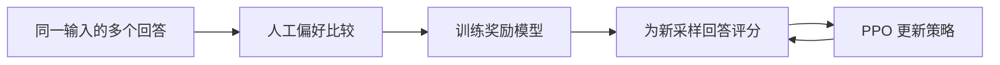
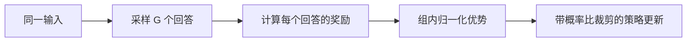

基础模型与指令模型可以拥有相近的架构，面对同一个请求却表现不同。输入“用两句话解释 KV Cache”，基础模型可能继续补全一段教程，指令模型则更倾向于按要求回答。后训练调整的，就是这种遵循指令和组织答案的行为。

训练方法需要按用途区分：SFT 使用示范回答，偏好优化使用回答之间的比较，RLVR 使用可验证奖励；PPO、GRPO、DAPO 则涉及策略如何更新。实际训练会根据数据和反馈条件组合这些方法。

## 一、预训练与后训练的目标

自回归预训练通常最小化下一个 token 的负对数概率：

$$\mathcal{L}_{PT}=-\frac{1}{T}\sum_{t=1}^{T}\log P(x_t\mid x_{<t};\theta)$$

模型由此学习语言、知识和数据中的各种模式。但训练语料的后续文本不一定是在执行用户指令：一个问题后面可能接答案，也可能接另一个问题或一段评论。因此，续写能力并不自动等于稳定的指令遵循能力。

后训练使用更贴近目标行为的数据与反馈。它能改善回答方式和任务表现，也仍然受信息来源限制。例如，客服模型要回答某个订单的到货时间，需要查询订单与物流数据；单靠对齐训练无法获得实时业务事实。

## 二、SFT：学习示范回答

SFT（Supervised Fine-Tuning）使用指令与回答组成的样本。示范既可以由人撰写，也可以经过模型生成、筛选和校验。数据需要体现希望模型遵守的格式、信息范围和任务要求。

```python
sft_example = {
    "instruction": "用两句话解释 KV Cache。",
    "response": "KV Cache 保存历史 token 在各层的 Key 和 Value。"
                "生成后续 token 时可以复用这些状态，减少重复计算。"
}
```

一种常见训练方式只在 assistant 回答上计算交叉熵，输入指令的 label 设为 `-100`。多轮对话中也可以在多个 assistant 片段上计算损失，具体由数据模板和训练配置决定。

下面展示回答部分的损失计算，省略分词、数据加载和对话模板构造。`response_start` 是已组装序列中回答开始的位置，由同一套对话模板与分词流程确定。

```python
import torch.nn.functional as F

def response_loss(logits, input_ids, response_start):
    # logits: [batch, sequence, vocab]
    labels = input_ids.clone()
    labels[:, :response_start] = -100
    # 位置 t 的输出预测位置 t+1 的 token
    return F.cross_entropy(
        logits[:, :-1].reshape(-1, logits.size(-1)),
        labels[:, 1:].reshape(-1),
        ignore_index=-100,
    )
```

示范质量、任务覆盖与样本数量共同影响效果。少量精选数据可能有效调整已有行为；扩大任务范围时，还需增加相应示范与覆盖。

SFT 直接提高示范回答的概率。若希望利用同一问题下“哪个回答更好”的比较，还需要引入偏好数据。

## 三、RLHF：用偏好训练奖励模型

以 PPO 为优化算法的一类 RLHF 流程，通常包括收集偏好、训练奖励模型和策略优化三个步骤。

先对同一输入采样多个回答，由标注者按准确性、相关性等标准比较。例如，“两句话解释 KV Cache”的偏好样本，可以把准确且满足长度要求的回答放在含错误机制或严重偏题的回答之前。标注准则应明确这些要求，让同类回答的比较保持一致。

奖励模型 $r_\phi(x,y)$ 为输入与回答打分。若 $y_w$ 优于 $y_l$，常见成对损失为：

$$\mathcal{L}_{RM}=-\mathbb{E}\log\sigma\big(r_\phi(x,y_w)-r_\phi(x,y_l)\big)$$

随后策略模型生成新回答，用奖励模型评分并更新。常见的正则化目标为：

$$J(\theta)=\mathbb{E}_{x,y\sim\pi_\theta}[r_\phi(x,y)]-\beta\mathbb{E}_{x}\,D_{KL}\big(\pi_\theta(\cdot\mid x)\|\pi_{ref}(\cdot\mid x)\big)$$

这里写的是奖励与 KL 惩罚组成的目标，并非 PPO 的完整 clipped surrogate loss。PPO 还需要用优势估计、概率比和裁剪机制约束每轮更新。

奖励模型只是人类偏好的近似。策略可能利用评分漏洞获得高分，却没有改善实际回答，这类问题称为 reward hacking。KL 惩罚可以限制相对参考策略的偏移，但不能保证消除奖励漏洞，奖励质量和更新方式仍需单独检查。



典型 PPO-RLHF 实现涉及策略、参考策略、奖励模型和价值模型。它们可能共享部分结构或采用不同的部署方式，但生成、评分、价值估计与更新仍带来较大的显存和调度成本。

## 四、DPO：直接利用偏好对

DPO（Direct Preference Optimization）从 KL 正则化奖励最大化问题推导出直接优化策略的偏好损失，无需单独拟合显式奖励模型，再运行 PPO 循环。

$$\mathcal{L}_{DPO}=-\mathbb{E}_{(x,y_w,y_l)}\log\sigma\left(\beta\log\frac{\pi_\theta(y_w\mid x)}{\pi_{ref}(y_w\mid x)}-\beta\log\frac{\pi_\theta(y_l\mid x)}{\pi_{ref}(y_l\mid x)}\right)$$

式中比较的是两个回答相对于参考策略的对数概率变化。训练提高偏好回答相对非偏好回答的优势；它不要求每个偏好回答的绝对概率都单调增加。

参考策略提供固定的比较基准，使目标由偏好对与相对策略概率共同决定。与奖励模型加 PPO 的流程相比，DPO 直接从同类偏好数据构造策略损失，减少了独立评分与在线优化环节。

标准离线 DPO 使用已有偏好数据，不在每轮更新中重新采样。它的工程流程较简单，但数据覆盖不足、偏好噪声和分布偏移仍会影响结果。需要在线探索时，可以另外组织采样与反馈循环。

## 五、GRPO：用组内奖励估计优势

[DeepSeekMath](https://arxiv.org/abs/2402.03300) 提出了 GRPO（Group Relative Policy Optimization），随后用于 DeepSeek-R1 等工作。它对同一输入采样一组回答，以组内奖励的统计量构造优势估计，省去单独训练的价值模型。

一种常见形式为：

$$A_i=\frac{r_i-\operatorname{mean}(r)}{\operatorname{std}(r)+\epsilon}$$

高于组内平均奖励的回答获得正优势，低于平均的获得负优势。这里使用奖励数值的标准化，并非只看排名。奖励既可以由规则提供，也可以来自奖励模型；GRPO 本身不规定奖励来源。



省去价值模型降低了部分训练成本，但组采样仍然需要生成多条回答。采样数量、回答长度和奖励方差会共同影响效率。如果组内奖励完全相同，归一化后的优势为零，这一组就没有基于奖励差异的策略梯度信号。KL 等其他目标项仍可提供梯度。

## 六、DAPO：调整采样与更新细节

[DAPO](https://arxiv.org/abs/2503.14476) 的名称来自 Decoupled Clip and Dynamic sAmpling Policy Optimization。它针对大规模推理强化学习中的探索、有效样本比例和长回答训练等问题调整策略优化流程。

- **Clip-Higher**：将概率比裁剪的上、下界解耦，放宽上界，给低概率动作的概率增长留出更多空间。
- **Dynamic Sampling**：过滤组内奖励没有差异的输入，并继续采样以补足有效批次。同一题目在策略变化后，也可能重新产生有差异的奖励。
- **Token-level Policy Gradient Loss**：在批次内按有效 token 聚合并归一化。与先在每条序列内平均、再对序列平均相比，较长回答在总目标中有更大的 token 权重。
- **Overlong Reward Shaping**：处理长度截断引入的奖励噪声，并在接近长度上限时引入软惩罚。这有助于区分错误答案与被长度上限截断的未完成推理。

这些改动需要结合采样实现与损失归一化理解。只复制一个裁剪阈值，无法复现整套训练行为。

## 七、RLVR：奖励由验证器提供

RLVR（Reinforcement Learning with Verifiable Rewards）描述奖励的获取方式。在数学、代码等领域，系统可以比较最终答案或运行测试，为采样结果提供自动反馈。它可以与 GRPO 等策略优化算法组合使用。

```python
def code_reward(code, test_cases, run_in_sandbox):
    """接口示意：沙箱负责超时、资源限制及错误隔离。"""
    for input_data, expected in test_cases:
        if run_in_sandbox(code, input_data) != expected:
            return 0.0
    return 1.0
```

自动验证减少了逐条人工比较回答的成本，但题目、标准答案和测试用例仍需构建与检查。通过有限测试不等于程序在所有输入上正确，奖励设计还需要防止格式投机、测试泄露和验证器漏洞。

[DeepSeek-R1 报告](https://arxiv.org/abs/2501.12948) 中，R1 的主要阶段包括冷启动数据微调、面向推理的强化学习、拒绝采样与再次 SFT，以及覆盖更广场景的强化学习。报告还讨论了向小模型蒸馏。R1-Zero 用于研究不经冷启动直接强化学习的行为，蒸馏模型则通过大模型生成的样本训练；三者的数据与阶段应分别理解。

实际设计后训练流程时，先确定反馈从哪里来：有可靠示范，可以做 SFT；有回答间的偏好，可以做偏好优化；有可执行的验证器，可以考虑 RLVR。之后再根据采样成本、硬件与训练稳定性选择优化算法。模型是否回答得更好，最终仍要由目标任务评估确认。
