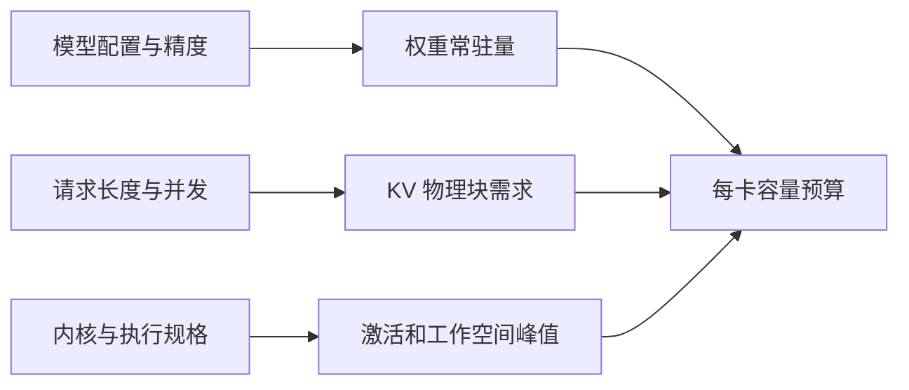

模型权重能装进显卡，并不意味着目标并发和上下文长度也能跑起来。推理还需要 KV Cache、激活、算子工作空间，以及 CUDA Graph 和通信缓冲区。容量规划需要把这些占用分开计算。

下面用 Qwen3-8B 作为 GQA 算例，配置取自[官方 config.json](https://huggingface.co/Qwen/Qwen3-8B/blob/main/config.json)：36 层、32 个 Q head、8 个 KV head、head dimension 128。这个固定算例用于解释计算方法；换模型时需要重新读取配置。全文使用 GiB（$2^{30}$ 字节）和 KiB（$2^{10}$ 字节），避免与十进制 GB 混用。

## 一、权重

未量化权重的存储量为：

$$M_W=N\cdot b_w$$

$N$ 是实际参数量，$b_w$ 是每个参数的字节数。Qwen3-8B 约有 8.2B 参数，用这个近似值计算：

| 权重格式 | 字节/参数 | 理论存储量 |
|---|---|---|
| FP32 | 4 | 30.55 GiB |
| BF16 / FP16 | 2 | 15.27 GiB |
| FP8 / INT8 | 1 | 7.64 GiB |
| INT4 | 0.5 | 3.82 GiB |

量化模型还会保存 scale、可能的 zero point 和部分高精度参数，实际占用高于仅按位宽计算的值。权重文件大小也不等于加载后的进程显存。

```python
params = 8.2e9  # 近似参数量
for name, width in [("FP32", 4), ("BF16", 2), ("FP8", 1), ("INT4", 0.5)]:
    print(f"{name}: {params * width / 2**30:.2f} GiB")
```

检查参数量时还要看输入 Embedding 与输出 lm_head 是否共享。Qwen3-8B 的 `tie_word_embeddings=false`，两者分别计入参数；若使用检查点已经给出的总参数量，就不要再重复相加。

## 二、KV Cache

对每层均采用全注意力的 MHA/GQA 模型，缓存一个 token 的 K/V 需要：

$$m_{KV}=2\cdot L\cdot H_{KV}\cdot d_h\cdot b_k$$

$L$ 是层数，$H_{KV}$ 是 KV head 数，$d_h$ 是每个 head 的维度，$b_k$ 是缓存数据类型的字节数。若活跃请求已经缓存的长度分别为 $s_1,\ldots,s_B$，则：

$$M_{KV}=m_{KV}\sum_{i=1}^{B}s_i$$

长度包括输入和已经生成的 token。所有请求长度相同时，求和可简化为 $B\cdot s$。不同长度的请求不应一律按当前最长请求计算，除非是在估算预留上限。

Qwen3-8B 用 BF16 保存 KV 时：

$$m_{KV}=2\times36\times8\times128\times2=147456\text{ bytes}=144\text{ KiB}$$

| 活跃请求数 | 每条已缓存长度 | KV 总量 |
|---|---|---|
| 1 | 4096 | 0.5625 GiB |
| 8 | 4096 | 4.5 GiB |
| 1 | 32768 | 4.5 GiB |
| 8 | 32768 | 36 GiB |

```python
def kv_bytes(lengths, layers=36, kv_heads=8, head_dim=128, width=2):
    per_token = 2 * layers * kv_heads * head_dim * width
    return per_token * sum(lengths)

print(kv_bytes([4096] * 8) / 2**30)   # 4.5 GiB
print(kv_bytes([32768] * 8) / 2**30)  # 36.0 GiB
```

这里必须使用 KV head 数。若误用 32 个 Q head，就会高估 4 倍。MHA 中 Q head 与 KV head 数相同，才可以进一步用隐藏维度化简。

该公式也有适用范围：MLA 缓存的是压缩表示及位置相关状态；混合注意力模型还可能包含固定大小的递归状态；滑动窗口层只需保留窗口内的缓存。它们需要按层类型分别计算。

PagedAttention 以块为单位分配缓存，最后一个未满块仍有内部碎片。前缀共享则可能让多个请求引用同一批物理块。容量规划要区分逻辑 token 总量与实际物理块占用。

## 三、激活与工作空间

权重和 KV 是持续保留的状态，激活则主要影响某次前向的峰值。两者不能用同一种生命周期估算。

朴素 Prefill Attention 会物化注意力分数矩阵。单层的分数张量大小约为：

$$M_S=B\cdot H_Q\cdot s^2\cdot b_s$$

例如 32 个 Q head、长度 4096、batch 8、分数以两字节存储，单个分数张量就是 8 GiB。它还不包括 softmax 等其他中间结果。推理通常不需要像训练那样为反向保存所有层的激活，因此这里也不能再简单乘层数。

FlashAttention 等融合实现通过分块计算，避免在 HBM 中保存完整的 $s\times s$ 矩阵。长上下文估算必须先确认实际 Attention Backend，不能把朴素实现的平方项直接加到融合内核的估算中。Decode 的 query 长度通常很短，也应与 Prefill 分开分析。

其他占用包括 Q/K/V 投影、FFN 中间激活、量化工作空间、CUDA Graph 内存池和通信缓冲区。其大小取决于本轮 token 数、内核及执行模式，无法固定为权重的某个百分比。Chunked Prefill 还会改变单轮激活峰值。



## 四、量化与张量并行

权重量化降低 $M_W$，KV 量化降低 $M_{KV}$，两者可以独立配置。例如，INT4 权重搭配 BF16 KV，与 INT4 权重搭配 FP8 KV，显存构成并不相同。能否启用这种组合，要看硬件、量化格式和 Attention Backend 的支持。

量化能节省多少显存，容易按字节估计；是否影响效果，则要在目标任务上验证。代码、长上下文和结构化输出的表现不能用一个通用的“下降不到一个点”概括。

张量并行会切分部分权重和 KV。以下是 Qwen3-8B 在 8 条、每条 32768 token、BF16 权重与 KV 条件下的理想切分值：

| TP 大小 | 每卡权重近似值 | 每卡 KV |
|---|---|---|
| 1 | 15.27 GiB | 36 GiB |
| 2 | 7.64 GiB | 18 GiB |
| 4 | 3.82 GiB | 9 GiB |
| 8 | 1.91 GiB | 4.5 GiB |

表中只列两项理论占用，尚未包含复制参数、激活和通信开销。KV head 能均匀切分时，缓存可以近似按 TP 大小分摊；当 TP 大于 KV head 数或后端采用复制策略时，不能继续线性除下去。增加 TP 也会引入通信延迟，需要同时验证吞吐和单请求延迟。

## 五、从公式到容量规划

单卡预算可以写成：

$$M_{\text{total}}\approx M_{W,\text{local}}+M_{KV,\text{physical}}+M_{\text{activation/workspace peak}}+M_{\text{runtime}}$$

前两项可以从配置和请求规模推导，后两项需要在实际框架中测量。对于 Qwen3-8B，BF16 权重加上 8 条 4K 请求的 KV，理论小计约为 19.77 GiB；8 条 32K 则约为 51.27 GiB。这些是部分占用的小计，不能直接当作推荐显卡容量或峰值上限。

部署前先用目标精度启动模型，记录权重加载、图捕获和缓存池分配后的占用，再用目标请求分布压测 Prefill 与 Decode。需要同时观察框架报告的 KV 容量、进程保留显存和运行时峰值：缓存池提前占用显存，并不等于其中所有块都已被请求使用。最后根据测得的峰值和业务波动保留余量，才能确定可用并发。
