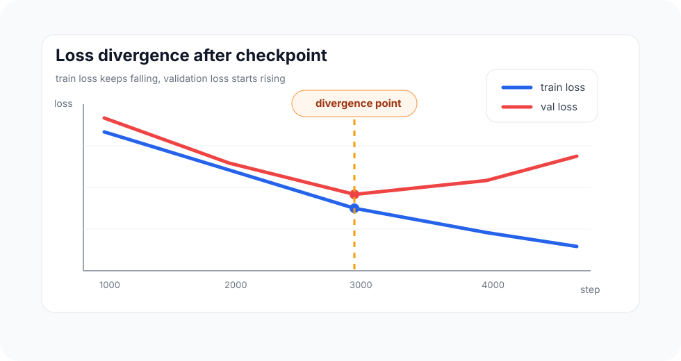
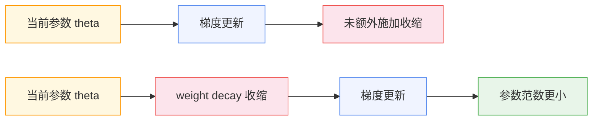
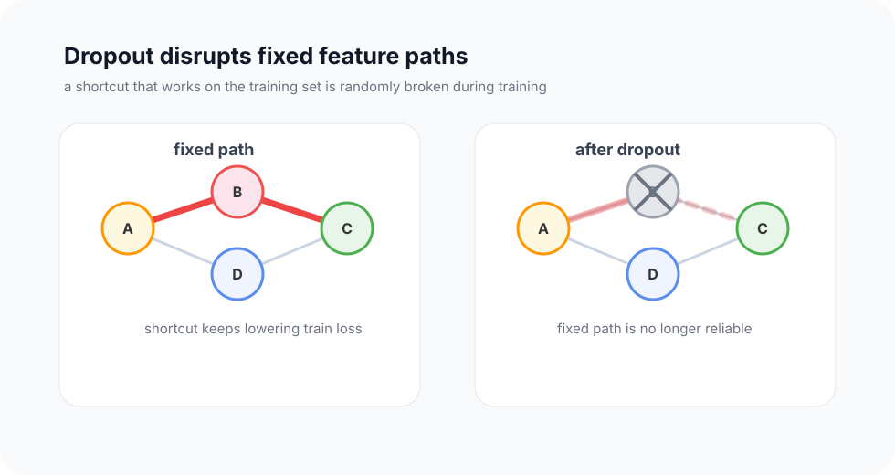
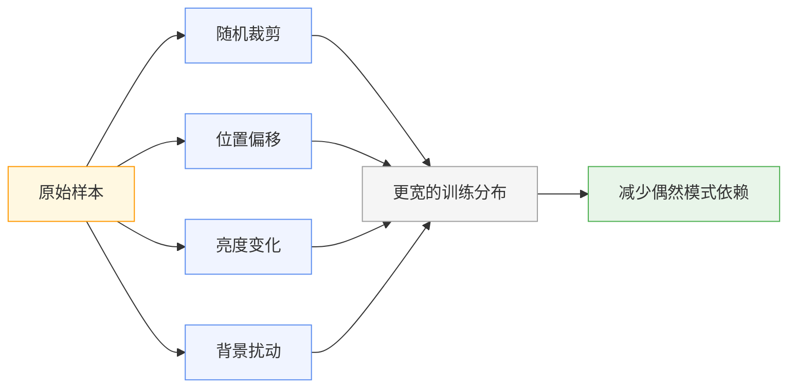
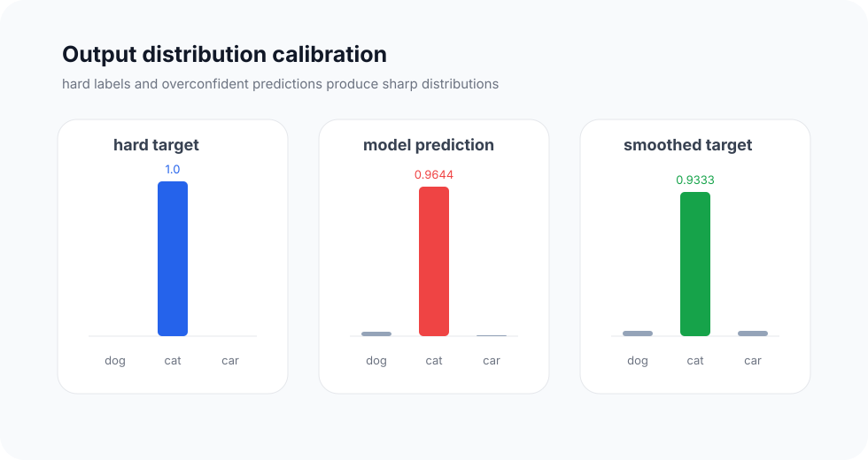

训练 loss 持续下降，验证 loss 却开始上升，是过拟合的常见信号。继续优化训练集不一定改善未见样本上的表现。

正则化通过限制参数、扰动激活或改变训练目标等方式影响模型学习。本篇分别讨论 weight decay、dropout、数据处理和 label smoothing，以及它们各自适用的条件。

## 一、泛化误差与过拟合信号

观察两条曲线前，先确认评估数据、损失归一化和训练／推理模式一致。若这些条件没有变化，训练 loss 下降、验证 loss 持续反弹，才值得进一步排查过拟合。下面是一组示意日志：

```text
step 1000: train loss = 2.41, val loss = 2.50
step 2000: train loss = 1.92, val loss = 2.05
step 3000: train loss = 1.61, val loss = 2.08
step 4000: train loss = 1.38, val loss = 2.21
```



这组日志中，验证 loss 在 2000 step 最低，之后升高。若以验证 loss 选择 checkpoint，4000 step 的模型并不优于 2000 step，即使训练 loss 更低。

可以用验证损失与训练损失的差值观察泛化差距：

$$\text{generalization gap} = \mathcal{L}_{\text{val}} - \mathcal{L}_{\text{train}}$$

泛化差距既受拟合程度影响，也受训练与验证分布、随机扰动和评估方式影响。应在相同评估条件下比较其变化。

正则化改变优化目标或训练过程，希望减少模型对训练样本中特有模式的依赖。它可能使训练 loss 更高，是否改善泛化需要在验证集上确认。

---

## 二、参数范数约束

较大的参数范数可能放大某些输入扰动，但参数范数与泛化的关系也受架构、归一化和参数化方式影响。L2 正则在任务损失之外加入参数平方和，直接惩罚较大的范数：

$$\mathcal{L}' = \mathcal{L} + \lambda \|\theta\|_2^2$$

系数 $\lambda$ 控制惩罚强度。比较不同配置时，还要确认哪些参数参与正则化。

对不带 Momentum 的 SGD，L2 正则可以对应到权重衰减，系数需按损失定义换算。因为 L2 项对参数的梯度是 $2\lambda\theta$，更新时会多减掉一项和当前参数成正比的值：

$$\theta_{t+1} = \theta_t - \eta \nabla \mathcal{L}(\theta_t) - 2\eta\lambda\theta_t$$

最后一项就在把参数往 0 拉。

下面用固定梯度展示权重衰减的收缩效果；它不模拟真实训练，也不验证泛化。初始参数为 $[3,-4]$，代码中的 `weight_decay=0.1` 对应每步乘以 $1-\eta\cdot0.1$，若按上面的 L2 定义换算，则 $\lambda=0.05$。

```python
import math

w_no_decay = [3.0, -4.0]
w_decay = [3.0, -4.0]
lr = 0.1
weight_decay = 0.1
grad = [0.2, -0.1]

for _ in range(5):
    w_no_decay = [w - lr * g for w, g in zip(w_no_decay, grad)]
    w_decay = [w * (1 - lr * weight_decay) - lr * g for w, g in zip(w_decay, grad)]

norm = lambda v: math.sqrt(sum(x * x for x in v))
print("no_decay_norm", round(norm(w_no_decay), 4))
print("decay_norm", round(norm(w_decay), 4))
print("no_decay_weight", [round(x, 4) for x in w_no_decay])
print("decay_weight", [round(x, 4) for x in w_decay])
```

输出：

```text
no_decay_norm 4.9003
decay_norm 4.6572
no_decay_weight [2.9, -3.95]
decay_weight [2.755, -3.755]
```



在这组固定梯度下，额外衰减让最终参数范数更小。真实训练中梯度也会随参数变化，因此还需要比较验证集表现。

Adam 会对含 L2 项的梯度做自适应缩放，因此 L2 与直接权重衰减不再等价。AdamW 将衰减从梯度统计中分离，具体机制见 Optimizer 一篇。它控制更新中的收缩方式，并不保证参数范数不再增长或模型不会过拟合。

除了参数范数，还可以在训练时随机扰动激活，减少模型对固定特征组合的依赖。

---

## 三、特征共适应抑制

特征共适应指多个特征在训练中形成相互依赖的组合。若某种组合只在训练分布内可靠，测试表现可能下降。

例如，背景纹理总与标签同时出现时，模型可能依赖背景而非目标物体本身。改变这种依赖，需要对训练过程或数据分布施加干预。

Dropout 是一种干预方式。训练时，它会随机把一部分激活置 0，让模型不能每次都依赖同一组神经元。

常见实现使用 inverted dropout：训练时保留下来的激活会除以 $1-p$，这样期望值和原始输入保持一致。推理时不再随机失活，直接使用完整网络。

```python
import random

random.seed(42)
x = [1.0] * 10
p = 0.5

y = [0.0 if random.random() < p else value / (1 - p) for value in x]
print(y)
print("nonzero", sum(1 for value in y if value != 0.0))
print("mean", round(sum(y) / len(y), 4))
```

输出：

```text
[2.0, 0.0, 0.0, 0.0, 2.0, 2.0, 2.0, 0.0, 0.0, 0.0]
nonzero 4
mean 0.8
```

这一次随机只保留了 4 个位置。样本太短，所以均值只有 0.8；维度变大、多次采样后，平均值会接近原来的 1.0。



随机失活使每步可用的激活组合变化，从而削弱对某些固定组合的依赖。这通常不会直接节省同等比例的算子计算量。

Transformer 的不同实现可能在 Attention 权重、FFN 或残差分支使用 dropout，具体位置和概率由架构决定。

一些大模型配置关闭了部分 dropout。例如 Qwen3-8B 的 `attention_dropout=0`。关闭注意力 dropout 后，权重衰减和数据处理仍可提供其他形式的约束。[官方配置](https://huggingface.co/Qwen/Qwen3-8B/blob/main/config.json)

Dropout 是否有效取决于数据规模、模型与训练目标。数据重复和覆盖不足时，随机失活不能替代数据处理。

---

## 四、训练分布扩展

训练分布覆盖不足时，模型可能利用局部相关性，而这些相关性在实际输入中不成立。

图像分类里，如果猫总是出现在画面中央，模型可能学到“中央有一团毛茸茸纹理”就判成猫。训练集上这条规则很好用，测试时猫偏到角落，规则立刻失效。

随机裁剪、翻转与颜色扰动，让训练样本覆盖更多位置、亮度和背景变化。前提是增强之后标签仍然正确。

```text
原始样本：一只猫在画面中央
增强样本：猫偏左、猫偏右、亮度更暗、背景裁掉一部分
```



这些变化会压低模型对偶然模式的依赖。它不能只记住“中央纹理”，因为同一只猫被移动过、裁剪过、调色过。

文本任务麻烦一些。图像左右翻转后，猫还是猫；一段文本替换几个词后，语义可能已经变了。尤其是指令数据和代码数据，随便改 token 很容易破坏约束。

LLM 的数据处理还包括去重、清洗和混合比例控制。生成或改写增强样本时，需要检查事实、代码语义与指令约束是否保留。

重复样本尤其危险。如果一段文本在训练集中出现很多次，模型会得到过多机会记住它。它学到的会逐渐偏离“这类句子该怎么写”，更接近“这段原文就是答案”。对语言模型来说，这不仅影响泛化，还可能带来记忆和泄露风险。

去重减少某些原文的重复权重，清洗过滤无效或错误样本，混合比例控制不同来源的训练机会。这些操作改变了模型实际拟合的数据分布。

这部分和数据处理文章可以衔接起来看。数据 pipeline 不只是把原始语料变成 token，它也在决定模型会反复看见什么、忽略什么、记住什么。

泛化表现之外，还需要单独检查输出概率是否可靠：准确率相同的模型，也可能有不同的置信度校准。

---

## 五、输出分布校准

分类模型可能对错误答案也给出很高概率。

这类模型在训练集上经常很好看。正确类别概率被推到 0.99，其他类别被压到接近 0，cross entropy 很低。但实际使用时，置信度本身也会参与决策：是否拒答、是否触发人工审核、是否把结果交给下游系统。

one-hot 目标会放大这个倾向：正确类别是 1，其他类别全是 0。

```text
真实类别 = cat
目标分布 = [dog: 0.0, cat: 1.0, car: 0.0]
```

One-hot 交叉熵鼓励正确类别概率趋近 1。拟合训练标签的同时，模型可能产生过于集中的预测分布，但过度自信还受模型、数据和训练过程影响。

Label Smoothing 把目标分布软化一点。假设有 3 个类别，$\epsilon=0.1$，原来的 $[1, 0, 0]$ 会变成：

$$[0.9333, 0.0333, 0.0333]$$

正确类别仍然最高，但不再是绝对的 1。其他类别也不再是绝对的 0。

用一组 logits 看交叉熵变化：

```python
import math

logits = [4.0, 0.5, -1.0]
max_logit = max(logits)
exp_values = [math.exp(v - max_logit) for v in logits]
probs = [v / sum(exp_values) for v in exp_values]

hard_target = [1.0, 0.0, 0.0]
eps = 0.1
classes = 3
smooth_target = [eps / classes] * classes
smooth_target[0] += 1 - eps

cross_entropy = lambda target: -sum(t * math.log(p) for t, p in zip(target, probs))

print("probs", [round(v, 4) for v in probs])
print("hard_ce", round(cross_entropy(hard_target), 4))
print("smooth_ce", round(cross_entropy(smooth_target), 4))
print("smooth_target", [round(v, 4) for v in smooth_target])
```

输出：

```text
probs [0.9644, 0.0291, 0.0065]
hard_ce 0.0363
smooth_ce 0.3196
smooth_target [0.9333, 0.0333, 0.0333]
```



同一组 logits 下，hard-label 交叉熵约为 0.0363，平滑标签的交叉熵约为 0.3196。后者对非目标类别也分配了正权重，因此对非常集中的预测施加不同约束。两个目标的 loss 数值不能直接当作模型质量比较。

Label smoothing 可能改善校准，但需要用独立验证数据检查，例如比较可靠性曲线、校准误差和准确率。上面的例子只展示目标函数怎样变化。

不过 label smoothing 也不是默认正确。某些生成任务需要模型精确拟合目标 token 分布，过强的 smoothing 会降低学习信号。尤其是数据本身已经有噪声时，继续软化标签可能把边界弄得更模糊。

这些方法分别作用于参数、激活、数据或输出目标。下一步要根据验证表现选择，而非同时增大所有强度。

---

## 六、正则化强度选择

同样是 val loss 反弹，不能上来就把所有正则化开关都调大。那样很容易把问题从过拟合改成欠拟合。

先检查数据重复、分布偏差和评估流程，再调整 weight decay、dropout 等训练参数。参数范数增长可以作为线索，但不能单独决定正则化强度；每次改动应与相同预算的基线比较。

如果主要问题是置信度偏高，可比较 label smoothing 与训练后的温度缩放等校准方法，观察准确率和校准指标是否同时满足要求。

还有一种情况最容易误伤：train loss 和 val loss 都高。这个时候优先加正则，往往会让问题更糟。模型本来还没学会，再加约束只会更难拟合。该先检查学习率、模型容量、数据质量和训练步数。

保留每次实验的数据版本、训练预算与评估口径，才能区分正则化收益和其他配置变化。达到更低训练 loss 与得到更适合部署的模型，是需要分别验证的两件事。
