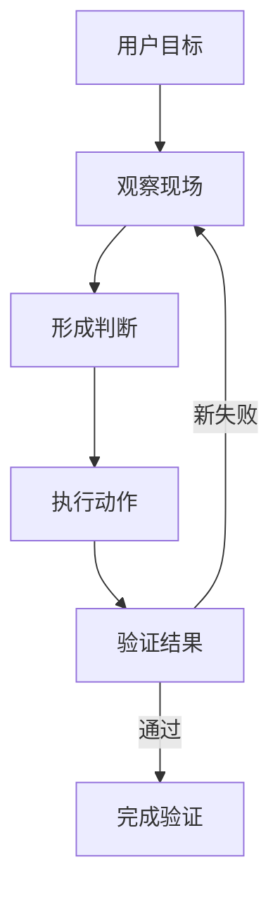
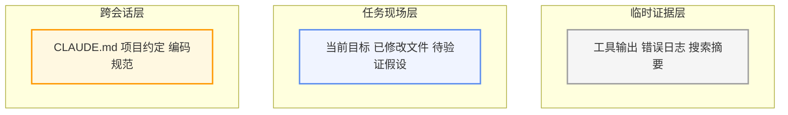
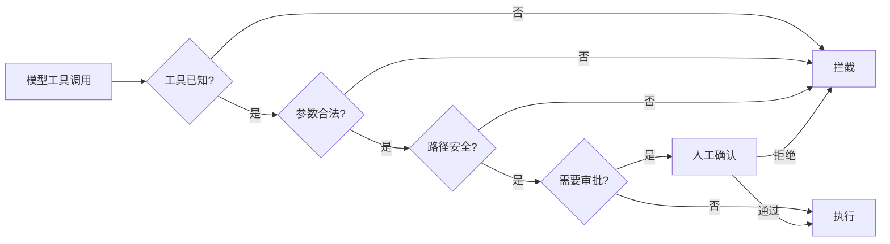

让模型修复测试失败，需要的不只是一段修复建议。系统还要运行测试、读取堆栈、允许模型查看和修改文件，再把验证结果交回模型，供它决定下一步。

Agent Harness 负责组织这些执行与反馈，管理工具、上下文和权限。模型能力仍然重要，同一模型获得的环境信息和工具不同，任务表现也会改变。本文沿着执行回路、上下文管理、操作边界与分工展开。

## 一、执行回路

修复测试通常经历运行、定位、修改、再验证等步骤。可以先做计划，但具体操作需要根据执行结果调整，例如首次失败可能来自依赖配置，而非待修改的业务逻辑。

模型可以根据已有信息预测下一步，却无法提前知道命令在当前环境中的真实结果。工具反馈为后续判断提供证据：测试是否通过、文件是否存在、改动是否引入新错误。

Agent Harness 解决这个问题的办法是让 LLM 进入一个执行回路。

Claude Code 文档用收集上下文、执行动作、验证结果概括回路。这些活动会交错发生，一次工具调用可能只完成其中一部分。[工作机制说明](https://code.claude.com/docs/en/how-claude-code-works)

一次修复中的工具调用可以是：

- 模型输出 `run tests` → Harness 执行并返回输出
- 模型根据输出决定 `read_file("src/foo.py")` → Harness 返回文件内容
- 模型判断问题位置并发出 `edit` 调用 → Harness 应用到文件系统
- 模型再次触发 `run tests` → Harness 返回新结果

Harness 执行获准的工具调用，将输出和错误反馈写回上下文。模型据此继续操作或结束任务；普通文本输出并不会自动成为系统操作。

启动时可以收集 Git 状态、项目说明和适用的工作区约定，让模型了解当前分支与已有改动。收集范围要有边界，避免无关日志或敏感配置进入上下文。

文件系统工具让模型按需读写材料，也能把较长的中间结果保存为文件，后续再检索。[LangChain 的 Harness 分析](https://www.langchain.com/blog/the-anatomy-of-an-agent-harness) 将它视为持久状态与上下文管理的基础组件。

每轮执行都会产生代码片段、日志和假设。全部保留会增加输入成本，并让过期信息干扰后续判断，因此执行回路还需要管理信息的保留与读取。

## 二、上下文分层

长上下文可能降低模型稳定利用相关信息的能力，Anthropic 的上下文工程文章将这类现象称为 context rot。这种信息利用问题还受任务、信息位置和模型影响，需要通过具体任务评估。[原文](https://www.anthropic.com/engineering/effective-context-engineering-for-ai-agents)

上下文管理需要关注哪些信息支持当前决策，而不只是还剩多少 token 容量。

Compaction 将历史记录压缩为后续工作所需的摘要，例如当前目标、已完成改动、未解决问题和验证结果。何时触发、如何生成摘要、保留哪些原始消息，由具体 Harness 实现决定。

更底层的信息分层不只在 compaction 时才发生。Anthropic 的文章还提到了两种策略：

- **JIT context loading**：模型不预加载所有信息，而是通过轻量级工具（文件大小、命名约定、目录结构）先判断哪些值得读，再按需读入。这比把整个工作区都塞进 prompt 给模型要高效。一个只读少量关键配置文件和按需取文件的模式，远好于试图加载全部。
- **Progressive disclosure**：先用低成本方式获取概况，再决定是否深入。这对应人类工程师的工作习惯——先看目录结构，再决定打开哪个文件，而不是同时读所有文件。

输入还可以按变化频率组织。较稳定的工具描述和项目约定放在前部，有助于前缀缓存；最新请求与工具结果在每轮更新。工作区状态可能随编辑变化，应在更新后重新组织输入。

文件中的内容也不需要全部预加载。目录、路径和检索工具让模型知道材料在哪里，再按任务读取；AGENTS.md 等约定的加载范围则由产品规则决定。

信息生命周期可以分为三层：

- **跨会话层**：CLAUDE.md、AGENTS.md、项目约定——每次会话都加载但不频繁变化
- **任务现场层**：当前目标、已修正的文件、待验证假设——当前会话持有时更新
- **临时证据层**：单次工具调用返回结果、错误输出、搜索摘要——用完可丢弃

跨会话约定可由启动加载或按目录加载提供，任务状态需要在压缩后仍能恢复，临时证据可以摘要或截断。重要结论最好保留来源路径，便于重新核查，而不是只能相信压缩后的转述。

写文件和执行命令会改变工作区状态，错误判断因此也可能产生实际影响。执行回路需要在操作前检查权限，并在操作后验证结果。

## 三、边界与分工

执行回路和上下文分层让 LLM 能够持续推进复杂任务，但也带来了两类风险。

第一类是操作风险。LLM 可能误写关键配置文件、执行不安全命令、访问越权路径。这些错误在 chat 模式下最多给出坏建议，但在 Harness 模式下可能直接破坏系统状态。

第二类是上下文污染风险。长任务中的探索过程会大量消耗上下文——读十几个文件、排除三条错误假设、做两次局部重构尝试。如果所有中间结果都留在主线上下文里，等到真正定位到根因时，上下文里已经堆满了无用信息。

操作边界可以由权限检查、Hooks 和沙箱共同约束。独立的探索上下文则可以减少无关过程信息进入主任务。

### 权限验证

工具执行前可检查名称、参数、目标路径与授权范围。路径验证还需处理规范化和符号链接等细节，不能只依靠模型在文字上承诺遵守约定。

Hooks 可以在工具调用前检查请求并拒绝不允许的操作。例如，写入工具命中某类受保护路径时，规则返回拒绝。具体 hook 事件与返回格式以所用产品版本为准；这类检查应覆盖实际可用的写入路径。

沙箱通过文件系统、进程和网络隔离限制操作影响。权限验证与隔离互补，能限制哪些动作可执行、动作最多影响哪里；其效果取决于隔离配置。

### Sub-agent 分工

独立调查可能产生大量被排除的假设。将它放到单独上下文中，再返回结论与证据，可以减少主任务携带的过程信息。

Sub-agent 可以接收一个明确子任务，在独立上下文中调查，最后返回发现、来源和未解决问题。主 agent 仍需检查结论是否满足原任务约束；摘要长度没有适合所有任务的固定值。

上下文隔离与并行是两个维度：子任务可以串行调查，也可以并行执行。若多个 agent 同时修改共享文件，还需要明确文件归属与合并方式，避免覆盖彼此改动。

执行回路提供反馈，上下文管理保留当前判断所需的信息，权限与隔离约束操作影响。评估 Harness 时，可以用同一组任务记录完成率、工具失败、上下文压缩后的遗漏，以及最终验证是否充分，而非仅比较提示词长度或调用次数。

**参考资料**

- [Anthropic：Effective Context Engineering for AI Agents](https://www.anthropic.com/engineering/effective-context-engineering-for-ai-agents)
- [LangChain：The Anatomy of an Agent Harness](https://www.langchain.com/blog/the-anatomy-of-an-agent-harness)
- [Claude Code 工作机制](https://code.claude.com/docs/en/how-claude-code-works)
