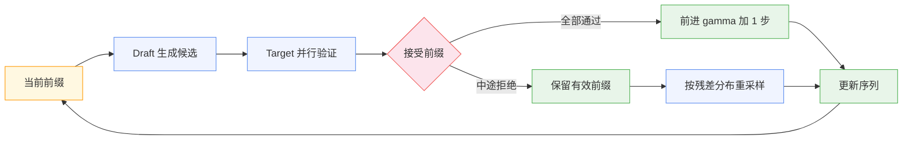
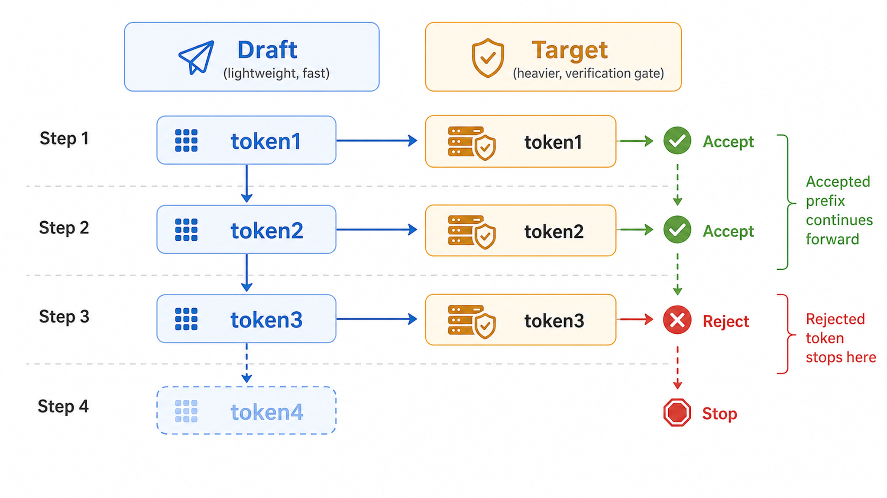
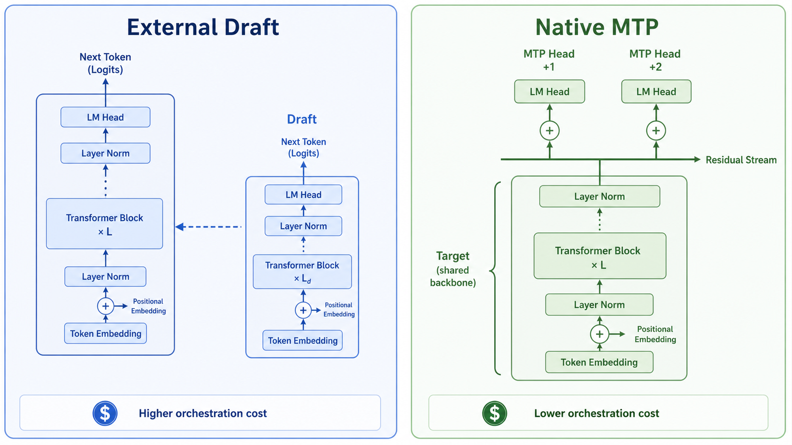

低并发自回归生成中，模型每次前向通常只为每条序列推进一个 token。权重需要反复读取，而计算量不足以充分利用 GPU，Decode 可能受显存带宽限制。

投机解码（Speculative Decoding，SD）用较便宜的草稿提出多个候选，再由目标模型并行验证。MTP（Multi-Token Prediction）可以为这个过程提供随模型训练的草稿模块。两者分别涉及解码流程和训练目标。

## 一、串行 Decode

这里先讨论低并发、权重访存占主要开销的 Decode。高并发、长上下文或 MoE 场景还可能受计算、KV 读取和通信限制。

对全部权重参与计算的 Dense 模型，batch=1、BF16 权重时，粗略估计每步约 $2N$ FLOPs，对应 $2N$ 字节权重读取，算术强度约为 1 FLOP/byte。只计权重读取的理想耗时下界为权重字节数除以 HBM 带宽。下面用假设的 70B、140 GB 权重说明量级：

| 硬件 | HBM 带宽 | 70B FP16 单 token 下界 |
|------|----------|------------------------|
| A100 40GB | 1555 GB/s | $\sim$90 ms |
| H100 SXM | 3.35 TB/s | $\sim$42 ms |

表中只是带宽除法，140 GB 权重无法直接放入这些单张显卡；实际部署需要多卡、卸载或量化，再按各卡数据量和通信重算。Prefill 通常能让同一批权重服务多个输入位置，提高算术强度；Decode 也可以通过批处理在多条请求间分摊权重读取。

量化和缩小模型降低每步成本，投机解码则尝试减少目标模型推进同样长度所需的串行轮数。它们可以组合使用。

SD 改的就是步数：一次 target forward，能不能推进多个 token。

## 二、先猜再验

SD 的结构分四步：

1. 用一个更快的 draft 模块自回归生成 $\gamma$ 个候选 token；
2. 把当前序列连同候选拼成一段，target model 一次 forward 并行算出 $\gamma+1$ 个位置的分布；
3. 逐位置决定接受还是拒绝，取最长有效前缀，拒绝点之后的候选丢弃；
4. 在拒绝点按所用验证规则补采 token；若候选全被接受，则从额外位置的 target 分布采样一个 token，再进入下一轮。

草稿与目标模型的职责分别为：

- Draft 负责便宜地提出路径；
- Target 负责裁定哪些 token 可以进入最终输出。

验证规则因解码策略而异。greedy 下最简单：接受 draft token 当且仅当它等于 target 在该位置的 argmax，首个不匹配处截断，并取 target 的 argmax 补上。sampling 下用 Leviathan 等人的拒绝采样规则：draft 分布 $q$ 提出的 token $x$，以

$$\min\left(1,\; \frac{p(x)}{q(x)}\right)$$

的概率接受；拒绝时从归一化的残差分布 $\text{norm}\big(\max(0,\; p - q)\big)$ 重采。这条规则保证最终序列的分布与 target 独立采样完全一致——draft 猜错只会浪费这一轮提议，不会改变任何输出概率。

低并发、访存受限时，多个候选位置可以共享一轮权重读取，利用部分计算余量。但验证仍有 Attention、激活和调度成本，候选越长也不一定越划算。[Leviathan 等人的论文](https://arxiv.org/abs/2211.17192) 在特定 T5-XXL 配置上报告了 2–3 倍加速；其他模型需按对应的验证与调度成本评估。采样规则保持目标分布，也不等于每次运行都生成相同序列。

一轮目标模型前向可能接受多个候选，从而减少串行验证轮数。

## 三、Draft 的成本

框架成立，不等于一定加速。收益可以用一个式子估出来。

先采用简化成本模型：各位置以相同条件接受率 $\alpha$ 继续，草稿长度为 $\gamma$，草稿单步耗时是目标模型单步的 $c$ 倍，并近似认为批量验证耗时等于一次目标前向。则：

$$\mathbb{E}[A] = \frac{1-\alpha^{\gamma+1}}{1-\alpha}, \qquad \text{Speedup} = \frac{\mathbb{E}[A]}{\gamma c + 1}$$

代入几组数：

| $\alpha$ | $\gamma$ | $c$ | $\mathbb{E}[A]$ | 加速 |
|----------|----------|-----|-----------------|------|
| 0.75 | 5 | 0.1 | 3.29 | 2.19x |
| 0.60 | 5 | 0.1 | 2.38 | 1.59x |
| 0.75 | 10 | 0.1 | 3.83 | 1.92x |
| 0.75 | 5 | 0.3 | 3.29 | 1.32x |

这组假设下，接受率降低或草稿变慢都会减少收益；增加候选长度则同时增加可接受长度和草稿成本，所以存在取舍。表中 $c=0.3$ 仍能得到大于 1 的估计加速，说明草稿速度的要求与接受率、候选长度有关。实际比较还需把批量验证与调度成本纳入分母。

低并发时，投机验证可能降低单请求延迟。高并发时，额外候选会占用本可服务其他请求的计算与缓存资源，收益取决于接受长度、组批方式和验证效率。因此要分别测量延迟与饱和吞吐。

常见草稿来源包括：

- 独立小模型：通用性最好，代价是 tokenizer 对齐、双模型调度、额外显存一整套成本；
- n-gram / suffix：从 prompt 自身检索候选，零模型成本，在代码补全、RAG 回显这类重复度高的场景命中率可观，对缺少重复片段的生成任务则可能命中较少；
- Medusa：在主模型上加多个并行预测头，训练量小，但各头独立预测、缺乏位置间依赖；
- EAGLE：在特征层面做单层自回归草稿头，需要单独训练草稿模块，接受率受任务与版本影响；
- 树状候选：SpecInfer 把单链候选扩成 token tree，一次验证覆盖多条路径，需要树注意力与更复杂的调度。

草稿来源会改变权重占用、训练成本、tokenizer 兼容性和调度方式。这些成本需要与接受长度一起评估。

## 四、MTP：训练多 token 预测

MTP 将多个未来位置的预测纳入训练目标。训练后的模块可以用作草稿，但仍需在服务侧接入验证流程。

[Meta 2024 年的工作](https://arxiv.org/abs/2404.19737) 在共享主体之上训练多个未来 token 预测头，研究其对学习效率和自投机推理的影响。多 token 辅助目标增加了预测任务，其收益需要结合模型规模与训练计算预算理解。

DeepSeek-V3 换了一种结构。它放弃了并行独立头，让每个 MTP 模块保持完整因果链地顺序预测：第 $k$ 层模块把上一层的表示与下一个 token 的 embedding 各自 RMSNorm 后拼接，经线性投影进入一个 Transformer block，再共享主模型的输出头：

$$h'^k_i = M_k\big[\text{RMSNorm}(h^{k-1}_i);\ \text{RMSNorm}(\text{Emb}(t_{i+k}))\big], \qquad P^k_{i+k+1} = \text{OutHead}\big(\text{TRM}_k(h'^k_i)\big)$$

DeepSeek-V3 的 MTP 模块共享主模型的 Embedding 和输出头。报告采用一个额外预测深度，研究了该辅助目标及其用于投机解码的效果。这类设计将草稿训练并入主模型训练；实际接受率和 TPS 还取决于服务负载与验证成本。[DeepSeek-V3 技术报告](https://arxiv.org/abs/2412.19437)

EAGLE 类方案通常单独训练草稿模块，MTP 则可与主模型训练结合。两者在参数共享和训练流程上不同，但都需要检查草稿与目标分布的匹配程度，再据此选择草稿方式。

SD 组织候选提议与验证，MTP 提供一种模型侧的候选来源。用 MTP 做无损投机加速时，仍需经过目标模型验证，并执行与目标采样分布一致的接受规则。

## 五、部署时的验证

MTP 提供一种草稿来源，独立小模型、检索候选和树状草稿也各有适用条件。部署时应把草稿成本、验证成本及其占用的服务资源一起计算。

落地时的观察指标也该随之调整：

- 接受率与平均接受长度：草稿贡献了多少有效推进长度；
- TTFT 与 ITL：延迟形态是否改善，分别观察首 token 与后续 token 延迟；主要优化目标通常是 Decode；
- 同卡 batch 上限：draft 权重与激活是否挤占了 KV Cache 空间；
- 峰值吞吐：在相同请求分布和延迟约束下，验证额外计算是否减少了整体服务能力。

启用投机解码后，先确认验证规则与采样配置正确，再比较接受长度、ITL 和饱和吞吐。单请求变快，但草稿占用挤压了批量上限时，整体收益仍可能下降。
