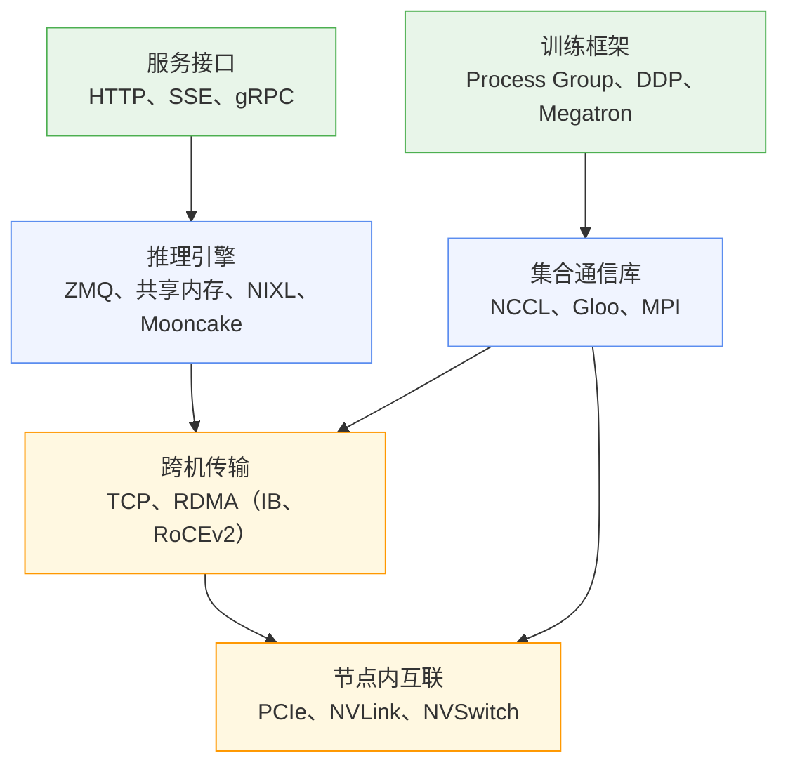
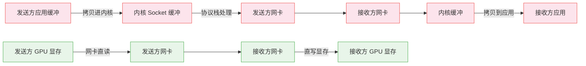
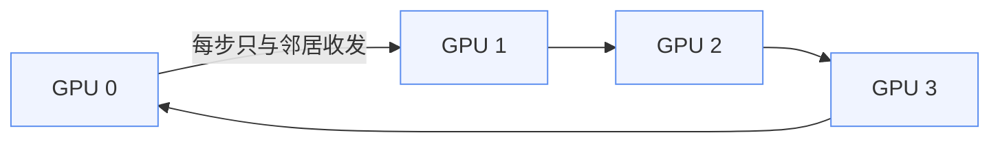
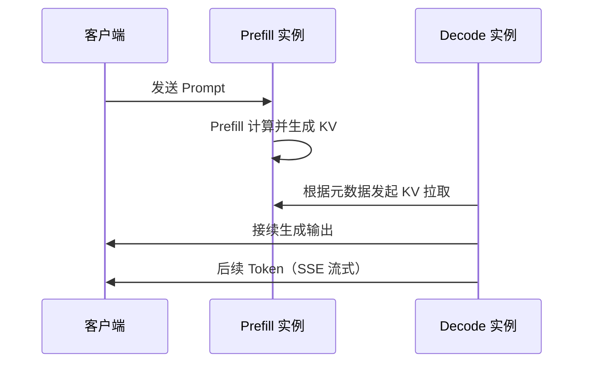

训练同步梯度、MoE 分发激活、推理服务搬运 KV，都需要把数据放到下一步计算所在的位置。它们对消息大小、带宽、延迟和同步方式的要求不同，但会共享 GPU 互联、网卡和传输库。

NCCL、RDMA、InfiniBand、NVLink、NIXL 与 gRPC 分属不同层次。下面从硬件通路到服务接口，说明它们各自处理什么，以及并行策略如何使用这些组件。图中箭头表示主要依赖关系，不穷举每种部署路径。

## 一、节点内互联

节点内数据传输主要经过 PCIe 或 NVLink 等互联。GPU、CPU 和网卡的连接拓扑，会影响可用带宽、P2P 能力以及并行策略的实际成本。

PCIe 连接 GPU、CPU 与网卡。Gen5 x16 单向理论数据带宽约为 64 GB/s，实际传输还受协议开销和拓扑影响。同交换机下的 GPU 可能直接 P2P；跨 CPU 插槽路径是否支持直传，还受平台和配置约束。频繁同步的张量并行需要先确认这些路径。

NVLink 提供 GPU 间专用互联，NVSwitch 将多张 GPU 接入交换网络。对比带宽时，应区分单链路、每卡聚合、单向与双向口径。AllReduce 可以沿环或树组织收发，并不要求每对 GPU 都直接交换；All-to-All 的通信分布则更依赖各目标的流量。

节点内互联和跨节点网络的带宽差异，也会影响模型路由。[DeepSeek-V3 报告](https://arxiv.org/abs/2412.19437) 使用 Node-Limited Routing，限制每个 token 涉及的节点数。它减少跨节点目的地，不意味着所有专家通信都被留在节点内。

因此，选择并行度前需要同时检查模型产生的通信量和设备之间的实际通路。

## 二、跨机传输

跨出机箱后，第一个问题变成：数据由谁来搬。

常规 Socket 通信由 CPU 执行协议处理，并可能涉及应用与内核缓冲区之间的复制。卸载、零拷贝与批处理会改变这条路径的开销，实际复制次数和延迟由系统实现决定。

RDMA 通过注册内存与网卡访问权限，让数据传输避开常规内核数据路径。READ/WRITE 可以采用单边操作，远端不必为每次传输主动调用接收，但内存注册、元数据交换、连接建立与同步仍需要软件管理。GPUDirect RDMA 允许网卡访问 GPU 显存，省去经主机内存中转的部分复制；IBGDA 等 GPU 发起机制进一步减少提交操作时的 CPU 参与。[DeepEP](https://github.com/deepseek-ai/DeepEP) 将这类机制用于专家 Dispatch/Combine，具体路径取决于通信模式与硬件支持。

RDMA 可由不同网络承载，常见实现包括：

- **InfiniBand**：使用专用网络与基于信用的链路流控，降低拥塞丢包；这不等于链路故障或传输错误不会发生。
- **RoCEv2**：在以太网上承载 RDMA。常见部署结合 ECN、拥塞控制和 PFC 管理拥塞，PFC 也可能带来队头阻塞与反压。具体是否依赖 PFC，要看网卡和网络设计。
- **iWARP**：在 TCP 上实现 RDMA，可靠传输由 TCP 提供。其拥塞和丢包行为遵循底层 TCP 传输机制。

大消息要测有效带宽，小消息要测端到端延迟与波动。网卡标称速率不能反映内存注册、排队、软件提交和同步的全部成本；实验应注明消息大小、拓扑和并发。

## 三、集合通信的组织

点对点传输提供基础收发，集合通信则规定一组进程如何共同交换和规约数据。GPU 训练常使用 NCCL；调用方还需保证各 rank 的操作顺序、数据类型和元素数量符合接口约定，否则可能挂起或产生错误。

AllReduce 将各 rank 的输入规约后返回每个 rank；AllGather 收集各 rank 的分片；ReduceScatter 规约后分散结果；All-to-All 将不同片段发往不同 rank。MPI 提供更通用的消息传递接口，NCCL 面向 GPU 集合通信，Gloo 也常用于 CPU 张量与控制同步。[NCCL 集合操作文档](https://docs.nvidia.com/deeplearning/nccl/user-guide/docs/usage/collectives.html)

同一原语可以使用不同算法与传输协议。算法决定数据交换顺序，协议决定分块、同步与传输方式，选择受消息规模、拓扑及软件版本影响。

以下是几类常见算法或硬件加速路径，并非所有版本的完整列表。

- **Ring**：经典 Ring AllReduce 包含 ReduceScatter 和 AllGather 两阶段，共 $2(K-1)$ 步。每个 rank 主要与环上邻居交换，适合摊薄大消息传输成本；卡数增加时，通信轮数也增加。
- **Tree**：用树形传播减少通信深度，常用于降低小消息延迟。是否优于 Ring，仍取决于消息大小和拓扑。
- **NVLS**：利用支持 NVLink SHARP 的硬件进行规约或多播，减少部分由 GPU 完成的数据汇聚工作，需要对应的设备与软件支持。
- **CollNet**：利用网络集合通信加速能力，例如支持 SHARP 的网络规约。硬件卸载改变了计算位置，但不代表所有数据交换都可被省去。

NCCL 的 Simple、LL 和 LL128 使用不同的数据分块与就绪标记方式，在带宽利用率、同步成本和延迟之间取舍。LL 类协议通过额外标记让接收端判断数据是否就绪，标记本身占用传输空间，也需要满足内存可见性与顺序要求。

NCCL 还会使用通道、切块与流水来重叠收发和规约。具体 kernel 的驻留与提交行为取决于执行模式。排查性能时，应先查看当前版本实际选择的算法、协议与传输路径。

配置不符合预期时，通信仍可能通过较慢路径继续执行。例如跨机连接使用 Socket，或节点内 P2P 不可用而经过其他路径。可启用 `NCCL_DEBUG=INFO`，结合拓扑和带宽测试确认实际路径；性能下降幅度需要按消息大小测量。

## 四、训练框架如何调用通信库

框架层把并行策略翻译成对集合通信的调用。PyTorch 的 Process Group 是这层的基本抽象：进程按不同含义编组，组的划分就是并行策略的拓扑。

- **数据并行（DDP）**：梯度被分成多个 bucket，反向传播中每个 bucket 就绪就立即触发 AllReduce，通信与剩余的反向计算自然重叠。bucket 大小直接影响重叠效率：太小则 AllReduce 次数多、步数开销大，太大则首次同步被推迟。
- **FSDP / ZeRO-3**：按需 AllGather 参数、ReduceScatter 梯度，用额外通信换取训练状态分片。是否在前向后重新分片、反向前是否再次聚合，由策略决定；每卡峰值还包括临时完整参数和激活，不能只按卡数线性除。
- **张量并行**：按矩阵维度切分计算，使用规约或聚合合成结果。经典 Megatron 的列并行与行并行配对会在每层产生多次同步；序列并行与其他变体会改变原语。频繁同步使 TP 对互联敏感，通常优先放在高速互联域，但跨机并非绝对不可用。
- **流水线并行**：相邻 stage 交换激活与梯度。气泡、stage 耗时不均与通信延迟共同影响利用率，通信量是否更小要结合切分位置和微批大小计算。
- **专家并行**：按照路由结果分发激活并返回专家输出，通常需要 All-to-All 类交换。DeepEP 等专用库会结合设备拓扑、数据类型与 GPU 发起通信优化这条路径。

TP、DP、PP 与 EP 常组合使用。分配设备时，需要把各并行组的消息大小、频率和可重叠时间映射到实际网络，避免只按某个单项带宽选并行度。

## 五、推理服务的通信栈

推理既可能使用 TP/EP 的集合通信，也需要引擎进程间消息、实例间状态传输与对外流式协议。下面按这三类路径展开。

引擎内部需要交换请求、调度结果与输出。vLLM V1 的多进程设计使用 ZMQ 等机制连接 API Server 与 EngineCore，部分同机数据交换可以使用共享内存。传输成本取决于进程部署与组件路径，排查时需要确认序列化、复制及是否跨机。

Prefill/Decode 分离时，Decode 实例需要获得已有 KV 后才能继续生成。用 Qwen3-8B 的 BF16 KV 算例，32768 token 的缓存为 4.5 GiB，约 4.83 GB。在单个 400 Gbit/s 端口、50 GB/s 理论带宽下，仅全量传输的带宽下界约为 0.097 秒，尚未计入协议、同步和排队。可复用前缀、分层传输与计算通信重叠会改变实际需要搬运的数据量和关键路径。

[NIXL](https://github.com/ai-dynamo/nixl) 提供统一的数据传输接口与可插拔后端，减少引擎直接依赖某种传输实现的工作。引擎可以采用 Decode 侧拉取的方式组织 KV 交接，但 pull 不等于一定使用某条 RDMA READ 路径，更不代表发送侧不需要注册内存、交换元数据或维护传输状态。Mooncake 等系统还把分布式 KV 存储与传输组合起来；比较时需同时看缓存命中、存储层次和有效传输带宽。

对外接口常用 HTTP 接收请求，以 SSE 返回增量内容。一个事件可以包含文本片段、工具调用片段或其他字段，字、token 与事件不是一一对应关系。gRPC 则提供基于 protobuf 的接口与流式能力，是否更合适取决于客户端生态、代理支持和服务间调用方式。

KV 交接影响首 token 或后续 token 的等待，具体取决于第一枚 token 由哪一侧返回及交接时机。上图展示 Decode 接续生成的简化流程，第一枚 token 也可以先由 Prefill 侧返回，再等待后续交接。

排查通信时，先确定数据量、消息频率和同步点，再查实际通路、有效带宽与等待时间。RDMA 减少部分 CPU 数据路径，集合算法组织收发，传输调度决定何时交接；每层都有具体成本，需要分别测量。
