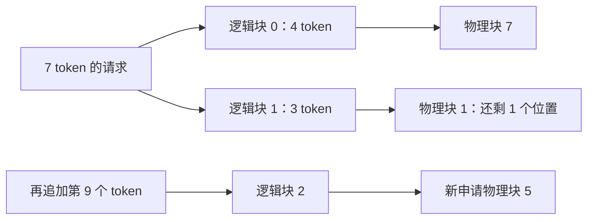
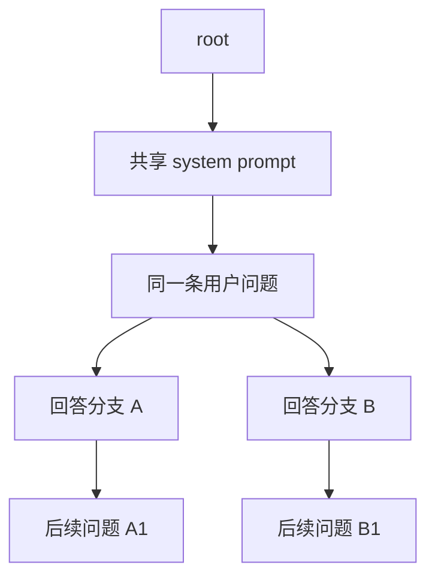

KV Cache 管理有两个相关的问题：请求不断增长时，怎样分配显存；不同请求出现相同前缀时，怎样找到可复用的状态。

PagedAttention 主要处理前一个问题，用块表访问非连续存放的 KV。vLLM 的 Automatic Prefix Caching（APC）在块管理之上增加哈希索引，SGLang 的 RadixAttention 则用基数树组织前缀。比较它们时，需要把物理存储、前缀匹配和淘汰策略分开。

## 一、连续预留的代价

如果一个实现按最大上下文长度为每条请求预留连续 KV 空间，那么短请求也会占住尚未使用的容量。以 Qwen3-8B 的 BF16 缓存为例，36 层、8 个 KV head、head dimension 128，单 token 的全部层缓存为：

$$m_{KV}=2\times36\times8\times128\times2=144\text{ KiB}$$

按 32768 token 预留，一条请求需要 4.5 GiB；若当前输入与已生成内容合计只有 4096 token，实际有效状态为 0.5625 GiB。这里比较的是同一假设分配策略下的预留量与有效量，不代表当前推理框架都采用连续预留。

未使用的预留空间属于内部浪费。若不同请求申请、释放不同大小的连续区域，分配器还可能留下难以利用的空隙。连续预留便于直接寻址，而块式布局通过映射表提供更灵活的分配方式。

[PagedAttention 论文](https://arxiv.org/abs/2309.06180) 针对早期服务系统讨论了这些问题。论文中的 OPT 等模型与实验数据用于描述当时的对照系统，下面用独立算例解释机制。

## 二、块表与按需分配

PagedAttention 将 KV 按固定 token 数切块。一个请求拥有连续编号的逻辑块，物理块则可以位于缓存池的不同位置。块表记录逻辑块到物理块的映射。

设每块容纳 $B$ 个 token，位置从零开始编号，则位置 $i$ 对应：

$$\text{physical block}=\text{table}[\lfloor i/B\rfloor],\qquad\text{offset}=i\bmod B$$

Attention Kernel 根据这个映射读取 K/V。注意力的数学定义不变，改变的是数据布局与寻址方式：

$$a_{it}=\frac{\exp(q_i^\top k_t/\sqrt d)}{\sum_{u=0}^{i}\exp(q_i^\top k_u/\sqrt d)},\qquad o_i=\sum_{t=0}^{i}a_{it}v_t$$

内核可以分块计算这些量，不需要先把所有 KV 拷成一段连续空间。块表会增加寻址与元数据访问，实际成本取决于内核、布局和负载，需要用实际负载比较。

下面用 $B=4$ 的小例子说明追加过程；实际 block size 由后端与配置决定。

追加第 8 个 token 时，最后一块还有空间，不必申请新块；第 9 个 token 到来时才分配新块并更新块表。对于单条、独占块的序列，未填满空间少于一块。块大小影响内部碎片、元数据规模、内核效率与复用粒度，需要一起衡量。

物理块还可以被多个逻辑序列共享。并行采样的分支先引用同一份 prompt KV；若要修改共享的未满块，则可用 copy-on-write 分配副本。引用计数与块回收由运行时管理，这里描述的是内存管理操作，并非要求应用直接调用某个固定的 `fork` API。

## 三、APC 的块级哈希

内存布局允许共享之后，还需要判断新请求的哪些前缀已经算过。vLLM APC 用块哈希建立索引。哈希可概括为：

$$h_j=\operatorname{hash}(h_{j-1},\ \text{tokens}_j,\ \text{extra identity})$$

父哈希包含此前的前缀信息，当前块包含本块 token；LoRA、多模态输入或缓存隔离信息等也可能参与标识。只比较当前块文本是不够的，因为同样的 token 在不同前文下会得到不同 KV。

新请求从前向后计算块标识并查询缓存。已缓存的完整块可以复用，未命中部分再做 Prefill。在 $B=16$、已有 200 token 公共前缀的例子中，按满块复用的上限是 12 块，即 192 token；后面的 8 token 需要重新处理。实际可用命中还受缓存是否写入、是否被淘汰等因素影响。

分支对话同样可以命中。例如 `[system, user, answer_A]` 与 `[system, user, answer_B]` 仍可共享分叉前相同的完整块。变化位置之后的 KV 依赖不同上下文，需要分别计算。哈希索引并不会因为后缀不同而让整段公共前缀失效。

引用计数归零表示没有活跃请求持有该块，块可以进入回收候选；其中的内容仍可能暂时保留，供新请求命中，直到被重新分配。哈希映射、空闲队列和引用计数需要协调更新。

块标识与回收过程可参阅 [vLLM APC 设计文档](https://docs.vllm.ai/en/latest/design/prefix_caching/)。例如 [vLLM v0.10](https://docs.vllm.ai/en/v0.10.0/configuration/engine_args.html) 的 V1 默认开启前缀缓存；部署时应检查所用版本的参数和模型支持。

## 四、RadixAttention 的前缀树

[SGLang 论文](https://arxiv.org/abs/2312.07104) 用基数树组织已计算的 token 前缀。基数树是压缩前缀树：一条边可以保存多个 token，相同前缀共用路径，分歧处形成分支；索引关联对应的 KV 存储位置。

新请求从根向下匹配。若匹配在一条边中间结束，可以拆分该边，保留公共部分，再插入不同后缀。匹配到且仍保留 KV 的前缀可直接复用。

树让前缀之间的包含与分叉关系显式可见。淘汰可以从没有活跃引用的叶节点开始；叶节点移除后，父节点是否成为新的候选，需要继续检查。这样可以在删除后缀时保留仍被其他分支使用的公共部分。

原论文实现讨论过 token 级 KV 管理；具体页大小、匹配对齐和缓存策略仍要结合所用版本、模型与 Attention Backend。使用基数树并不意味着所有实现都能在任意一个 token 处复用。

树索引也需要维护、匹配与锁定等操作。比较复杂度时，应对齐“处理一条请求”的工作量：单次哈希表查找平均为 $O(1)$，但整条前缀仍需计算并查询多个块，完整请求的开销需要累计这些操作。

## 五、用请求负载比较复用效果

| 维度 | vLLM APC | SGLang RadixAttention |
|---|---|---|
| 索引方式 | 带前缀依赖的块哈希 | 压缩前缀树 |
| 共同要求 | 被复用前缀的模型状态一致 | 被复用前缀的模型状态一致 |
| 公共前缀后的分支 | 可以复用分叉前的完整块 | 用树分支组织公共前缀与后缀 |
| 命中粒度 | 受块大小和后端约束 | 受页大小、对齐和后端约束 |
| 管理成本 | 块哈希、引用计数、回收队列 | 树匹配、节点维护、引用与淘汰 |

固定 system prompt、多轮对话和分支生成，都可能从前缀复用中获益。索引结构之外，缓存容量、请求路由、调度顺序、块粒度和内核也会改变结果。

选型时用同一组请求回放，固定模型、精度、硬件和并发，分别记录命中 token 数、需要重算的 Prefill token 数、TTFT、吞吐和缓存占用。如果匹配到了前缀但延迟没有改善，再检查排队与计算是否成为主要开销。这样才能把索引差异与整套引擎的其他差异分开。
