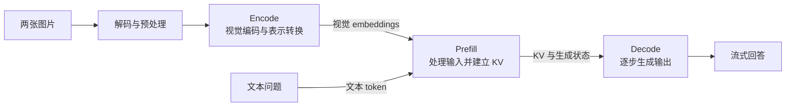
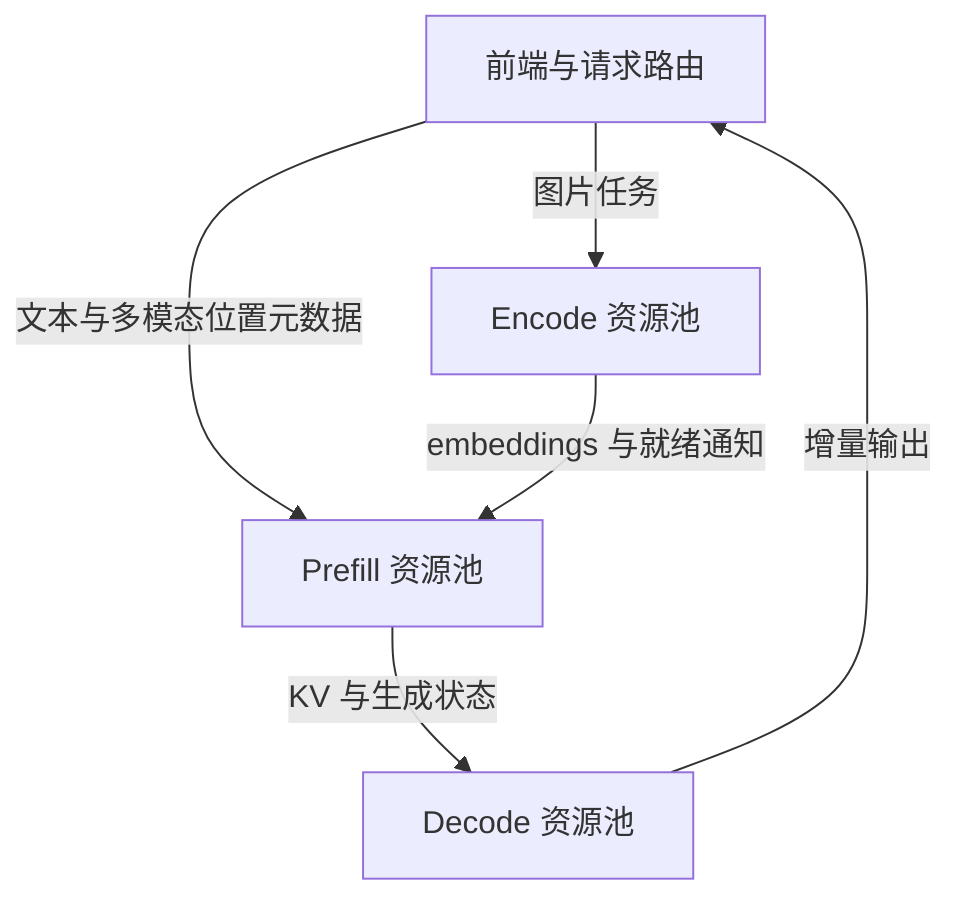

同样是一次问答，输入一段文字与输入多张高清图片，会给推理服务带来不同的负载。图片需要先完成解码、预处理和视觉编码，生成的视觉表示还会增加语言模型的输入长度。如果这些工作与文本生成共用资源，图片请求的到来就可能改变其他请求的排队时间和输出节奏。

PD 分离将 Prefill 与 Decode 放到不同实例上，分别处理输入与生成输出。多模态场景进一步引入了 Encode 阶段，形成 Encode–Prefill–Decode 三阶段链路。EPD 分离围绕这三个阶段划分调度和资源边界，让系统可以单独调整编码、输入处理和生成能力。

下面以视觉编码器连接自回归语言模型的图片理解架构为例，讨论执行流程、部署方式及其工程取舍。这里的 E 指多模态 Encode；纯文本请求的分词和词嵌入查表不单独构成本文的 E 阶段。

## 一、多模态推理链路

假设用户上传两张图片，并要求模型比较其中的差异。服务首先读取图片、解码并执行缩放、裁剪等预处理，再把结果交给视觉编码器。编码器输出经过必要的投影或合并后，形成语言模型可以消费的 embeddings。投影放在编码侧还是语言模型侧，取决于模型与服务实现。

这部分是 **Encode**。图片数量、分辨率及切图策略会影响编码工作量，因此两条文本长度相同的请求，也可能有很不一样的编码耗时。

接着进入 **Prefill**。语言模型按照模型约定，将文本表示与视觉表示组织成输入序列，执行前向计算，建立各层的 KV Cache，并得到预测首个输出 token 所需的 logits。视觉表示占据多少输入位置，由模型的压缩、合并和序列组织方式决定。

**Decode** 则接续已有 KV，逐步生成输出。每一步读取模型权重和已有上下文状态，计算新 token，并追加对应的 KV。本文讨论普通自回归路径，暂不展开推测解码等变体。

图中箭头表示数据依赖，并不要求每个方框都部署为独立服务。媒体预处理可以放在前端或编码 worker；图片解码与语言模型的 Decode 也属于两种不同操作。

三个阶段关注的资源不同。Encode 通常有较强的矩阵计算需求，也会产生临时激活；Prefill 一次处理多个输入位置，适合组织较大的矩阵运算；Decode 每一步处理的新增位置较少，在小批量下常受权重与 KV 的访存限制。批量、上下文长度、模型结构和并行度都会改变实际瓶颈，不能仅凭阶段名称判断硬件利用率。

## 二、PD 分离的局限

在共置服务中，长输入的 Prefill 可能占用较长执行时间，影响正在流式生成的请求。PD 分离把输入处理与持续生成交给不同实例，让两侧分别选择批处理、并行度和资源数量。[DistServe](https://arxiv.org/abs/2401.09670) 系统性讨论了这类干扰，以及按首 token 延迟和输出 token 延迟配置资源的方法。

但在多模态服务中，如果编码仍由 Prefill 实例承担，部署形态实际上是 EP/D。P 与 D 之间已经隔离，E 与 P 之间仍然共享调度和资源。

这种耦合会带来两类问题。第一类是执行干扰：编码耗时随图片负载波动。当实现把图片编码放在同一执行路径上时，文本请求也可能等待前面的图片任务完成。独立编码可以减少这部分等待，但是否发生整批阻塞，仍取决于具体引擎的调度实现。

第二类是资源配置受限。视觉编码器权重、编码激活与语言模型的权重、输入处理共用显存；编码吞吐不足时，增加一个 EP 实例往往还要增加一份语言模型资源。若此时语言模型侧已经有余量，这次扩容就难以充分利用。

Chunked Prefill 等机制可以缓解长 Prefill 对 Decode 的干扰，却不会自动建立独立的编码资源池。是否继续拆分 E，需要看编码是否已经成为可以观测到的瓶颈。

## 三、EPD 分离架构

为便于区分，下面用斜杠表示实例边界：

| 部署形态 | 实例职责 | 新增的跨实例交接 |
|---|---|---|
| EPD 共置 | 同一实例执行三个阶段 | 无阶段间远程交接 |
| EP/D | 编码与 Prefill 结合，Decode 独立 | KV 与生成状态 |
| E/PD | 编码独立，Prefill 与 Decode 结合 | 多模态 embeddings |
| E/P/D | 三个阶段分别部署 | embeddings、KV 与生成状态 |

EPD 分离的实现可以从 E/PD 开始，也可以进一步采用 E/P/D。[Dynamo 编码分离文档](https://docs.nvidia.com/dynamo/dev/multimodal/encoder-disaggregation) 给出了这两种部署路径。worker 的逻辑分离与 GPU 的物理隔离需要分别考虑：独立进程可以共享 GPU，获得各自的队列和批处理能力，但仍会争用计算与显存带宽。

完整的 E/P/D 请求大致经过以下过程：前端解析请求，编码池处理图片并发布 embeddings；Prefill 实例取得这些表示，与文本输入一起执行前向计算；Decode 实例取得 KV 和生成状态后，继续生成回答。纯文本请求直接进入 P/D 路径。

这张图描述逻辑依赖。实际系统可能由前端等待编码完成后再转发请求，也可能先选择下游实例，由下游协调编码。两种方式都需要明确中间结果的位置、就绪状态及释放责任。

两次交接传递的数据不同。E → P 交接的是编码输出，还需要保留图片顺序、切图布局和输入位置等模型所需的元数据。P → D 交接的是各层 KV，以及接续生成所需的 token、位置和采样状态等信息。KV 布局、数据类型及并行分片方式也必须兼容，或由传输层完成转换。

[vLLM 的分离示例](https://docs.vllm.ai/en/latest/examples/disaggregated/disaggregated_encoder/) 分别配置 Encoder Cache Connector 与 KV Connector，体现了这两个数据边界。它们不必使用相同的传输后端；部署前还需确认具体版本对模型、模态、拓扑和 connector 组合的支持。

## 四、性能收益

分离后的直接变化，是各阶段拥有独立的工作队列和资源配置。编码池可以按图片负载组织 batch；Prefill 池根据输入 token 数安排工作；Decode 池根据活跃序列、KV 容量和输出延迟调节并发。调度器因而不必在同一个执行批次里兼顾所有阶段。

由此可以形成跨请求流水线：请求 A 进入 Decode 时，请求 B 执行 Prefill，请求 C 执行 Encode。它提高了不同阶段同时工作的机会，但请求 C 仍要等待自身所需的视觉表示就绪，才能处理对应的多模态输入。单请求延迟与系统吞吐需要分别衡量。

对于包含多张独立图片的请求，编码任务还可以分发到多个 worker 并行执行，再按原始顺序汇合。单张图片内部能否进一步按切图并行，要遵循编码器结构，不能任意切断存在全局注意力依赖的输入。[EPD 原始论文](https://arxiv.org/abs/2501.05460) 将异步传输、请求内编码并行和资源配置优化组合起来，改善整条服务链路。

显存方面，真正只加载编码器的 E 实例可以省去语言模型权重；P/D 侧可以移除编码器权重及相应的临时激活。这有机会为更大的 batch 或 KV 池腾出空间。不过，视觉位置对应的语言模型 KV 仍然存在，分离不会让它们消失。

缓存还能减少重复编码。同一图片在相同模型、预处理与表示转换配置下，可以复用已有 embeddings。编码缓存也可以用于共置服务，EPD 分离只是让集中管理和跨实例复用更容易。命中编码缓存后，新的文本上下文通常仍要执行 Prefill；能否复用 KV，取决于完整前缀是否满足复用条件。

这些收益最终要落到固定成本下的吞吐和延迟上。如果编码本来只占很小一部分时间，增加独立队列和数据传输后，收益也可能被抵消。

## 五、工程代价

**通信量是首先需要估算的成本。** 若编码侧最终输出 $V$ 个视觉位置，每个位置的维度为 $d$、每元素占 $b$ 字节，则一次 E → P 交接的张量大小约为：

$$S_{EP}=Vdb$$

例如，假设每张图片输出 1024 个位置、维度为 4096、采用每元素 2 字节的表示，则每张图片为 8 MiB，四张图片为 32 MiB。这是独立算例，不对应某个模型的默认配置；投影前后的维度与传输量也可能不同。

对各层结构相同、使用普通 KV Cache 的模型，若有 $L$ 层、$N$ 个输入位置、$H_{KV}$ 个 KV head、每个 head 的维度为 $d_h$，每元素占 $b_{KV}$ 字节，则完整输入 KV 大小约为：

$$S_{PD}=2LNH_{KV}d_hb_{KV}$$

其中 2 代表 K 和 V。假设 $L=32$、$N=4096$、$H_{KV}=8$、$d_h=128$，KV 每元素 2 字节，则总量为 512 MiB。这里的 $N$ 包括进入语言模型序列的文本和视觉位置；算例按所有分片合计，忽略块填充、元数据和复制。压缩 KV、滑动窗口及其他注意力结构需要按实际布局重新计算。

若有效传输带宽为 25 GB/s，32 MiB 与 512 MiB 的纯数据传输时间分别约为 1.34 ms 和 21.47 ms，尚未包含固定同步、复制及排队开销。这两个数只用于量级估算。前缀复用可以减少实际交接量，逐层传输与计算重叠可以缩短暴露在关键路径上的时间；并发请求也会争用同一条链路。

**独立资源池还会增加权重副本与容量管理成本。** P 与 D 通常都需要语言模型权重，因此完整 E/P/D 需要分别为两个资源池配置权重容量。减少某个实例的峰值显存，不代表集群总显存或 GPU 数量一定减少。异构硬件能否节约成本，也要同时计入吞吐、网络和部署密度。

**背压决定流水线能否稳定运行。** 编码完成得快，而 P 没有可用容量时，embeddings 会积压；P 持续接收请求，而 D 的 KV 池已满时，交接也会停住。只按上游队列长度扩容，可能进一步推高下游的内存占用。

一种可行的控制方式，是在接收或推进请求前，结合下游预算限制在途任务，并对中间结果设置容量上限。对大小差异明显的多模态请求，只限制请求条数不够，还应估计视觉 token、KV 或字节占用。具体预留时机需要权衡：过早预留会让资源等待上游，过晚预留则可能形成积压。

**中间状态需要明确的生命周期。** 发送侧不能在异步传输完成前释放缓冲区；接收侧必须等数据可用后才启动依赖计算。请求取消或下游失败时，清理要覆盖编码任务、传输操作、embeddings 和 KV，避免只移除了前端请求却留下显存占用。

若保留 embeddings 供后续复用，缓存键还应包含媒体内容身份、模型版本及预处理配置。同一个图片 URL 不能保证内容永远相同。缓存驻留与活跃请求引用也需要分开管理，避免淘汰仍被使用的数据。

## 六、性能评估

评估应先固定比较口径。同一组 GPU 上比较，可以观察相同硬件预算下的收益；使用不同型号 GPU 时，应换算为相同费用下的有效吞吐。模型、权重与 KV 精度、输入输出长度、缓存条件及软件版本都应记录。

对照组至少包含共置、E/PD 和 E/P/D。已有 EP/D 部署时，也应保留它，以区分“拆分编码”与“拆分 Prefill/Decode”各自贡献。共置基线需要使用合理的批处理和调度配置。

负载应覆盖以下变化，而不只测试固定的一张图片：

| 负载维度 | 需要观察的变化 |
|---|---|
| 图片数量、分辨率与切图策略 | 编码耗时、视觉 token 数和峰值显存 |
| 文本输入长度 | Prefill 计算量和 KV 交接量 |
| 输出长度 | Decode 占比及 KV 持续占用 |
| 文本与图片请求比例 | 混合流量下的排队干扰 |
| 到达速率与突发程度 | 队列增长、背压及尾部延迟 |
| 编码缓存与前缀缓存命中率 | 编码复用和 KV 复用的分别贡献 |

客户端指标包括首 token 延迟 TTFT、输出 token 间隔 ITL、端到端延迟及其 P95/P99。平均 TPOT 可以描述生成阶段的平均速度，但会掩盖个别长间隔，因此还要检查逐 token 的停顿。

首 token 由哪一侧返回也会改变指标解释。若 P 完成后就返回首 token，P → D 的交接可能主要表现为首 token 到第二个 token 的间隔；若由 D 统一返回，交接等待可能计入 TTFT。测试报告需要注明口径。

有效吞吐可以定义为单位时间内同时满足既定 TTFT、输出延迟和成功条件的请求数。再按阶段记录排队、计算、传输、缓存命中与占用，才能解释吞吐变化的原因。提高到达速率时，还要确认队列没有持续增长；短时间内接收更多请求，并不能证明系统具备稳定处理能力。

这一节给出评估方法，本文不提供实测提速比例。实际收益需要在目标模型、互联和请求分布下验证。

## 七、适用边界

当多图、高分辨率输入较多，编码队列已经成为瓶颈，或者文本请求明显受到图片任务干扰时，可以优先评估 E/PD。它建立独立编码池，同时保留 P 与 D 的共置，减少一次 KV 远程交接。

当 Prefill 与 Decode 的干扰同样突出，而且有足够的并发、互联带宽和独立扩容需求时，再评估完整 E/P/D。编码侧适合多大 batch、P/D 各需要多少实例，都应从阶段耗时与队列数据中确定，不能按三个阶段平均分卡。

低并发、编码占比小或网络较慢时，共置往往更容易维持较短路径。输出很长、主要瓶颈集中在 Decode 时，单独扩展编码能力也难以显著改善端到端时间。若主要耗时发生在媒体下载和 CPU 预处理，首先需要处理的则是进入编码器之前的链路。

EPD 分离提供了更细的资源配置能力，也增加了通信、状态和调度成本。合理的拆分粒度，应当让新增边界对应一个真实瓶颈，并通过相同成本下的有效吞吐与尾部延迟证明它的价值。
